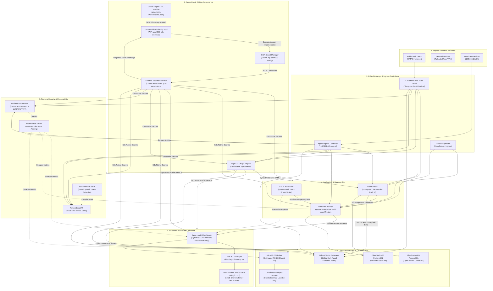

<pre align="center">
   ██████╗██╗███████╗ ██████╗██╗  ██╗ ██████╗  ██████╗  ██████╗       ██╗     ██╗     ███╗   ███╗ ██████╗ ██████╗ ███████╗
  ██╔════╝██║██╔════╝██╔════╝██║  ██║██╔════╝ ██╔═████╗██╔═████╗      ██║     ██║     ████╗ ████║██╔═══██╗██╔══██╗██╔════╝
  ██║     ██║███████╗██║     ███████║███████╗ ██║██╔██║██║██╔██║█████╗██║     ██║     ██╔████╔██║██║   ██║██████╔╝███████╗
  ██║     ██║╚════██║██║     ╚════██║██╔═══██╗████╔╝██║████╔╝██║╚════╝██║     ██║     ██║╚██╔╝██║██║   ██║██╔═══╝ ╚════██║
  ╚██████╗██║███████║╚██████╗     ██║╚██████╔╝╚██████╔╝╚██████╔╝      ███████╗███████╗██║ ╚═╝ ██║╚██████╔╝██║     ███████║
   ╚═════╝╚═╝╚══════╝ ╚═════╝     ╚═╝ ╚═════╝  ╚═════╝  ╚═════╝       ╚══════╝╚══════╝╚═╝     ╚═╝ ╚═════╝ ╚═╝     ╚══════╝
                                  <b>Cloud-Native Scalable AI Infrastructure</b>
               <i>Enterprise-Grade LLMOps, Zero-Trust GitOps, and AMD ROCm Hardware Accelerated AI Platform</i>
</pre>

<p align="center">
  
  
  
  
  
  
  
  
</p>

---

## 📑 Live Services & Endpoints Registry

| Tier | Service Name | Public Endpoint (Zero Trust) | LAN / Edge Direct (HTTP) | Internal Cluster DNS | Default Auth / Secret Source |
| :--- | :--- | :--- | :--- | :--- | :--- |
| **Frontend** | **Open-WebUI** | [open-webui.kung.nyc](https://open-webui.kung.nyc) | `http://open-webui.192.168.1.3.sslip.io` | `open-webui-svc.open-webui.svc:8080` | First user registered receives Admin |
| **Gateway** | **LiteLLM Gateway** | [api.kung.nyc](https://api.kung.nyc) | `http://api.192.168.1.3.sslip.io` | `litellm.litellm.svc:4000` | Bearer Token synced via ESO (`my-cisc4900-config`) |
| **Inference**| **llama.cpp ROCm** | *Internal Protected* | *Internal Protected* | `llamacpp-rocm-svc.llamacpp-rocm.svc:8080` | Bearer Token synced via ESO (`my-cisc4900-config`) |
| **Vector DB**| **Qdrant Vector DB** | [qdrant.kung.nyc](https://qdrant.kung.nyc/dashboard) | `http://qdrant.192.168.1.3.sslip.io/dashboard` | `qdrant.qdrant.svc:6333` | Read/Write API Key synced via ESO |
| **GitOps** | **Argo CD** | [argocd.kung.nyc](https://argocd.kung.nyc) | `http://argocd.192.168.1.3.sslip.io` | `argocd-server.argocd.svc:443` | Admin password managed via Bcrypt ESO patch |
| **Security** | **Falco Sidekick UI**| [falco.kung.nyc](https://falco.kung.nyc) | `http://falco.192.168.1.3.sslip.io` | `falco-falcosidekick-ui.falco.svc:2801` | Basic Auth synced via ESO (`my-cisc4900-config`) |
| **Monitor** | **Grafana Dashboard**| [grafana.kung.nyc](https://grafana.kung.nyc) | `http://grafana.192.168.1.3.sslip.io` | `lgtm-prometheus-grafana.grafana.svc:80` | Admin credentials synced via ESO |
| **Metrics** | **Prometheus LGTM** | *Internal Protected* | *Internal Protected* | `lgtm-prometheus-kube-prome-prometheus.grafana.svc:9090`| ServiceMonitor scraping endpoints |
| **Mesh VPN** | **Tailscale Operator**| *Tailnet Mesh VIP* | *100.x.y.z subnet* | `tailscale-pg-0.tailscale.svc` | Operator OAuth credentials synced via ESO |

---

## 🌟 Executive Summary

**CISC4900 Cloud-Native Scalable AI Infrastructure** is an enterprise-grade, turn-key LLMOps (Large Language Model Operations) private cloud platform engineered for production AI inference, retrieval-augmented generation (RAG), and intelligent multi-model orchestration. 

Built on a unified high-performance hardware foundation (**AMD Ryzen with Radeon 8060S Strix Halo gfx1151 GPU, 96GB Unified Host RAM, and ~62GB VRAM allocation**), the platform completely eliminates recurring public cloud token expenditures while providing strict enterprise sovereign governance over proprietary data.

### Key Architectural Pillars:
1. **Zero-Trust Network Perimeter**: Inbound traffic is secured via dual-replica **Cloudflare Zero Trust Tunnels** (`*.kung.nyc`) requiring no open firewall ports or public IPv4 addresses, backed by high-performance **Nginx Ingress** for LAN direct bypass (`*.192.168.1.3.sslip.io`) and **Tailscale Operator** for mesh VPN connectivity.
2. **Keyless Cross-Cloud SecretOps**: Eliminates static API keys and credentials across all Git repositories. Employs **Google Cloud Workload Identity Federation (WIF)** paired with an **OIDC Provider hosted on GitHub Pages** to grant **External Secrets Operator (ESO)** dynamic access to **Google Secret Manager**, strictly adhering to GCP Free-Tier limits (≤ 6 active secret versions and ≤ 10,000 monthly API calls).
3. **Declarative GitOps Lifecycle**: Automated through **Argo CD (`v3.6.2`)** utilizing Server-Side Apply to synchronize multi-namespace infrastructure, networking, storage, databases, and microservices in declarative sync waves.
4. **Hardware Accelerated LLM Serving**: Leverages **llama.cpp with ROCm GPU acceleration** running directly against virtualized `/dev/dxg` via WSL2 kernel passthrough, coupled with **LiteLLM Gateway** for OpenAI-compatible load balancing, session persistence, and rate limiting.
5. **High-Availability Storage & Databases**: Multi-instance **CloudNativePG PostgreSQL** clusters for application and gateway state, coupled with **JuiceFS CSI Driver** providing POSIX-compliant shared distributed file storage backed by **Cloudflare R2** object storage.
6. **Kernel-Level Runtime Defense & Observability**: Real-time eBPF syscall monitoring with **Falco** detecting privilege escalation and unauthorized shell execution, integrated with **Prometheus & Grafana LGTM** dashboards monitoring GPU VRAM, queue depth, TPS, and TTFT latency.
7. **Comprehensive 10-Tier Verification Suite**: End-to-end automated testing scripts validating pipeline connectivity, OWASP LLM Top 10 defenses, NetworkPolicy isolation, RAG precision, 32K context stress, and failover persistence.

---

## 🏗️ System Architecture & Data Flow



---

## 🗂️ Repository Structure & File Tree

<pre>
<b>E:\CISC4900 (WSL2: ~/)</b>
│
├── <b>00-Installation-Testing/</b>              # Master Deployment & Validation Suite
│   ├── <a href="file:///e:/CISC4900/00-Installation-Testing/Copy-SSH.bat">Copy-SSH.bat</a>                  # Windows-to-WSL silent individual file synchronization script
│   ├── <a href="file:///e:/CISC4900/00-Installation-Testing/00-Menu.sh">00-Menu.sh</a>                    # Interactive 4-column master CLI management menu (1~18 & 100~110)
│   ├── 01-Hardware-OS-Configuration.sh   # Host OS optimization, sysctl inotify tuning & base packages
│   ├── 02-AMD-ROCm-DXG.sh                # AMD GPU driver verification, librocdxg & diagnostic pod
│   ├── 03-Kubernetes.sh                  # K3s cluster deployment, OIDC issuer check & kubeconfig setup
│   ├── 04-Helm.sh                        # Helm 3 client installation & official chart repositories setup
│   ├── 05-External-Secrets-Operator.sh   # ESO deployment, GCP WIF secret configuration & CSS validation
│   ├── 06-Tailscale-Operator.sh          # Tailscale mesh VPN operator deployment & ProxyGroup setup
│   ├── 07-Cloudflare-Tunnel.sh           # Cloudflare Zero Trust dual-replica tunnel orchestration
│   ├── 08-Ingress-Nginx.sh               # Ingress-Nginx controller setup with hostNetwork direct binding
│   ├── 09-JuiceFS-CSI-Driver.sh          # JuiceFS CSI driver installation with Cloudflare R2 backend
│   ├── 10-CloudNativePG-DB.sh            # CloudNativePG operator deployment & controller verification
│   ├── 11-Qdrant-Vector-DB.sh            # Qdrant vector database deployment & Ingress configuration
│   ├── 12-ArgoCD-GitOps.sh               # ArgoCD GitOps engine installation & admin secret sync
│   ├── 13-Falco-Security.sh              # Falco modern eBPF driver deployment & Sidekick WebUI
│   ├── 14-Grafana-Prometheus-Stack.sh    # Prometheus & Grafana LGTM observability stack deployment
│   ├── 15-KEDA-Autoscaler.sh             # KEDA event-driven autoscaler deployment & ScaledObject setup
│   ├── 16-LLaMAcpp-ROCm.sh               # llama.cpp ROCm GPU server deployment with dynamic decoupling
│   ├── 17-LiteLLM-Gateway.sh             # LiteLLM gateway, ConfigMap, and dedicated CNPG database
│   ├── 18-Open-WebUI.sh                  # Open-WebUI chat portal deployment with dedicated CNPG database
│   ├── 100-Download-LLM.sh               # High-speed model downloader (Aria2 / HuggingFace CLI)
│   ├── 101-Test-AI-Stack-E2E.sh          # [Test 101] Full pipeline E2E verification (Qdrant->llama->LiteLLM->WebUI)
│   ├── 102-Test-Security-Penetration.sh  # [Test 102] NetworkPolicy micro-segmentation & Falco audit test
│   ├── 103-Test-RAG-Benchmark.sh         # [Test 103] Vector semantic search recall & closed-loop QA benchmark
│   ├── 104-Test-Concurrency-Throughput.sh# [Test 104] Multi-user concurrency, TPS, TTFT & KEDA autoscaling test
│   ├── 105-Test-Context-Stress.sh        # [Test 105] Stepped context window (1K~32K) & ROCm VRAM stress test
│   ├── 106-Test-Needle-In-Haystack.sh    # [Test 106] 32K context Needle-In-A-Haystack memory precision test
│   ├── 107-Test-LLM-Guardrails-OWASP.sh  # [Test 107] OWASP LLM Top 10 security audit (injection, jailbreak)
│   ├── 108-Test-Cluster-Security-Audit.sh# [Test 108] K8s RBAC least privilege, Pod Security & Secret isolation
│   ├── 109-Test-Storage-Persistence-Failover.sh # [Test 109] CSI storage, PostgreSQL ACID failover & self-healing
│   └── 110-Test-LLM-CLI.sh               # [Test 110] Interactive multi-turn CLI chatbot with dynamic routing
│
├── <b>01-Hardware-OS-Configuration/</b>         # Host Configuration & Environment
│   ├── .bashrc                           # User shell profile with KUBECONFIG and environment settings
│   ├── wsl.conf                          # WSL2 configuration (systemd=true, automount, network generation)
│   └── .cloudflared/                     # Cloudflare Zero Trust credentials and tunnel mapping config
│
├── <b>02-AMD-ROCm-DXG/</b>                      # AMD Hardware Acceleration & Diagnostics
│   ├── 1-AMD-ROCDXG-Namespace.yaml       # Dedicated namespace for ROCm diagnostic workloads
│   └── 2-AMD-ROCDXG-Deployment.yaml      # ROCm diagnostic pod mounting /dev/dxg & librocdxg.so
│
├── <b>03-Kubernetes/</b>                        # K3s Cluster Configuration
│   ├── config.yaml                       # K3s API Server arguments (specifying public OIDC Issuer)
│   └── k3s.yaml                          # Master Kubeconfig (0644 permissions, loopback API server)
│
├── <b>04-Helm/</b>                              # Kubernetes Package Management
│   └── init-helm-repos.sh                # Initializes 9 official repositories (Prometheus, Falco, etc.)
│
├── <b>05-External-Secrets-Operator/</b>         # Cross-Cloud Keyless SecretOps
│   ├── 1-External-Secrets-Namespace.yaml # external-secrets namespace manifest
│   ├── Google-Cloud-Platform-CSS.yaml    # ClusterSecretStore connecting to GCP Secret Manager
│   └── wif-credentials.json              # WIF client library configuration mapped to GitHub OIDC provider
│
├── <b>06-Tailscale-Operator/</b>                # Secure Mesh VPN Networking
│   ├── 1-Tailscale-Namespace.yaml        # tailscale namespace manifest
│   ├── 2-Tailscale-ProxyGroup.yaml       # Tailscale ProxyGroup configuring multi-device mesh routing
│   └── My-Tailscale-ExternalSecret.yaml  # Syncs Tailscale OAuth client credentials from GCP
│
├── <b>07-Cloudflare-Tunnel/</b>                 # Zero Trust Edge Perimeter
│   ├── 1-Cloudflare-KV-Namespace.yaml    # cloudflare-kv namespace manifest
│   ├── 2-Cloudflare-KV-ServiceAccount.yaml# Dedicated ServiceAccount for tunnel management
│   ├── 3-Cloudflare-KV-RBAC.yaml         # Role for secret and pod inspection
│   ├── 4-Cloudflare-KV-RoleBinding.yaml  # Binds tunnel role to ServiceAccount
│   ├── 5-Cloudflare-ES-RBAC.yaml         # ESO RBAC definitions for Cloudflare namespace
│   ├── 6-Cloudflare-ES-RoleBinding.yaml  # Binds ESO roles for Cloudflare credentials
│   ├── 7-Cloudflare-KV-CronJob.yaml      # Automatic DNS routing synchronizer CronJob
│   ├── 8-Cloudflared-Tunnel-Deployment.yaml # High-Availability dual-replica cloudflared tunnel
│   └── My-Cloudflare-ExternalSecret.yaml # Syncs Cloudflare Account ID & API Tokens from GCP
│
├── <b>08-Ingress-Nginx/</b>                     # High-Performance Ingress Routing
│   └── 1-Ingress-Nginx-Namespace.yaml    # ingress-nginx namespace manifest
│
├── <b>09-JuiceFS-CSI-Driver/</b>                # Distributed POSIX File Storage
│   ├── 1-Cloudflare-JuiceFS-StorageClass.yaml # StorageClass defining JuiceFS persistent volumes
│   ├── 2-Cloudflare-JuiceFS-Postgres.yaml# PVC allocating shared storage for database snapshots
│   └── My-Cloudflare-JuiceFS-ExternalSecret.yaml # Syncs JuiceFS format keys and Cloudflare R2 secrets
│
├── <b>10-CloudNativePG-DB/</b>                  # High-Availability PostgreSQL Operator
│   ├── 1-CloudNativePG-Namespace.yaml    # cnpg-system namespace manifest
│   └── 2-CloudNativePG-Operator.yaml     # CloudNativePG v1.25.0 operator deployment
│
├── <b>11-Qdrant-Vector-DB/</b>                  # Semantic Vector Search Engine
│   ├── 1-Qdrant-Namespace.yaml           # qdrant namespace manifest
│   ├── 2-Qdrant-Ingress.yaml             # Ingress manifest exposing Qdrant Dashboard and REST API
│   └── My-Qdrant-ExternalSecret.yaml     # Syncs Qdrant Read/Write & Read-Only API Keys from GCP
│
├── <b>12-ArgoCD-GitOps/</b>                     # Declarative Continuous Delivery
│   ├── 1-ArgoCD-Namespace.yaml           # argocd namespace manifest
│   ├── 2-ArgoCD-Ingress.yaml             # Ingress manifest exposing Argo CD Web UI (SSL Passthrough)
│   ├── 3-ArgoCD-Install.yaml             # Argo CD v3.6.2 complete official manifest
│   ├── ArgoCD-App-External-Secrets.yaml  # Argo CD Application syncing External Secrets Operator
│   └── My-ArgoCD-ExternalSecret.yaml     # Syncs and merges Bcrypt admin password into argocd-secret
│
├── <b>13-Falco-Security/</b>                    # Runtime eBPF Threat Monitoring
│   ├── 1-Falco-Namespace.yaml            # falco namespace manifest
│   ├── 2-Falco-Ingress.yaml              # Ingress exposing Falcosidekick Web UI
│   ├── My-Falco-Config.yaml              # Helm values configuring modern eBPF driver & existingSecret
│   └── My-Falco-ExternalSecret.yaml      # Syncs Falcosidekick Web UI username & password from GCP
│
├── <b>14-Grafana-Prometheus-Stack/</b>          # LGTM Observability & Metrics Stack
│   ├── 1-Grafana-Namespace.yaml          # grafana namespace manifest
│   ├── 2-Grafana-Ingress.yaml            # Ingress exposing Grafana visualization portal
│   ├── 3-Grafana-LLaMAcpp-ROCm.yaml      # Dedicated ConfigMap dashboard for ROCm & LLM throughput
│   ├── My-Grafana-Config.yaml            # Helm values configuring admin.existingSecret & plugins
│   └── My-Grafana-ExternalSecret.yaml    # Syncs Grafana admin credentials from GCP
│
├── <b>15-KEDA-Autoscaler/</b>                   # Event-Driven Pod Autoscaler
│   └── 1-LLaMAcpp-KEDA-ScaledObject.yaml # ScaledObject scaling llama.cpp based on HTTP queue depth
│
├── <b>16-LLaMAcpp-ROCm/</b>                     # ROCm GPU Accelerated LLM Inference Engine
│   ├── 1-LLaMAcpp-Namespace.yaml         # llamacpp-rocm namespace manifest
│   ├── 2-LLaMAcpp-PersistentVolumeClaim.yaml # PVC mounting HuggingFace GGUF models volume
│   ├── 3-LLaMAcpp-Deployment.yaml        # Deployment mounting /dev/dxg, librocdxg & model weights
│   ├── 4-LLaMAcpp-Service.yaml           # ClusterIP Service exposing OpenAI-compatible endpoints
│   ├── 5-LLaMAcpp-ServiceMonitor.yaml    # Prometheus ServiceMonitor scraping inference metrics
│   ├── 6-LLaMAcpp-NetworkPolicy.yaml     # Zero-Trust micro-isolation restricting traffic to LiteLLM
│   └── My-LLaMAcpp-ExternalSecret.yaml   # Syncs internal Bearer Token from GCP
│
├── <b>17-LiteLLM-Gateway/</b>                   # Multi-Model AI Gateway & Routing
│   ├── 1-LiteLLM-Namespace.yaml          # litellm namespace manifest
│   ├── 2-LiteLLM-Postgres-Cluster.yaml   # Dedicated CloudNativePG PostgreSQL 2-node HA cluster
│   ├── 3-LiteLLM-Deployment.yaml         # Deployment with multi-model routing & database pooling
│   ├── 4-LiteLLM-Service.yaml            # ClusterIP Service exposing port 4000
│   ├── 5-LiteLLM-ServiceMonitor.yaml     # Prometheus ServiceMonitor for TPS, latency & token usage
│   ├── 6-LiteLLM-NetworkPolicy.yaml      # NetworkPolicy restricting ingress to Open-WebUI & Ingress
│   ├── 7-LiteLLM-Ingress.yaml            # Ingress exposing public API at api.kung.nyc
│   ├── My-LiteLLM-Config.yaml            # Multi-model catalog config (Gemma 4, Qwen 3.6, Muse)
│   └── My-LiteLLM-ExternalSecret.yaml    # Syncs Master API Key & PostgreSQL credentials from GCP
│
├── <b>18-Open-WebUI/</b>                        # Production Generative AI Chat Portal
│   ├── 1-OpenWebUI-Namespace.yaml        # open-webui namespace manifest
│   ├── 2-OpenWebUI-Postgres-Cluster.yaml # Dedicated CloudNativePG PostgreSQL 2-node HA cluster
│   ├── 3-OpenWebUI-Deployment.yaml       # Deployment configured with LiteLLM & Qdrant RAG endpoints
│   ├── 4-OpenWebUI-Service.yaml          # ClusterIP Service exposing port 8080
│   ├── 5-OpenWebUI-NetworkPolicy.yaml    # NetworkPolicy enforcing strict namespace perimeter
│   ├── 6-Open-WebUI-Ingress.yaml         # Ingress exposing portal at open-webui.kung.nyc
│   ├── My-OpenWebUI-Config.yaml          # Portal configuration, branding, and feature toggles
│   └── My-OpenWebUI-ExternalSecret.yaml  # Syncs JWT secret, database credentials & Qdrant API keys
│
├── <b>K8s-OIDC-Provider/</b>                    # Public OIDC Identity Endpoint (GitHub Pages)
│   ├── .well-known/
│   │   └── openid-configuration          # RFC 8414 OIDC discovery metadata JSON
│   └── jwks.json                         # Public JSON Web Key Set matching K3s service account keys
│
└── <b>(0) ~ (18) Operations Runbooks:</b>
    ├── (0)Installation-Testing.txt       # Master automated menu and validation guide
    ├── (1)Hardware-OS-Configuration.txt  # OS setup, kernel parameters, and inotify tuning runbook
    ├── (2)AMD-ROCm-DXG.txt               # AMD Strix Halo GPU virtualization & driver verification
    ├── (3)Kubernetes.txt                 # K3s cluster installation and OIDC configuration runbook
    ├── (4)Helm.txt                       # Helm 3 setup and repository configuration runbook
    ├── (5)External-Secrets-Operator.txt  # GCP WIF and ESO 6-stage disaster recovery runbook
    ├── (6)Tailscale-Operator.txt         # Tailscale mesh VPN setup and proxy group runbook
    ├── (7)Cloudflare-Tunnel.txt          # Cloudflare Zero Trust dual-replica tunnel runbook
    ├── (8)Ingress-Nginx.txt              # Ingress-Nginx controller setup and hostNetwork runbook
    ├── (9)JuiceFS-CSI-Driver.txt         # Distributed POSIX JuiceFS storage setup runbook
    ├── (10)CloudNativePG-DB.txt          # High-Availability PostgreSQL operator runbook
    ├── (11)Qdrant-Vector-DB.txt          # Qdrant semantic vector database setup runbook
    ├── (12)ArgoCD-GitOps.txt             # Argo CD GitOps continuous delivery runbook
    ├── (13)Falco-Security.txt            # Falco modern eBPF threat monitoring setup runbook
    ├── (14)Grafana-Prometheus-Stack.txt  # Prometheus & Grafana LGTM stack setup runbook
    ├── (15)KEDA-Autoscaler.txt           # KEDA event-driven autoscaling runbook
    ├── (16)LLaMAcpp-ROCm.txt             # llama.cpp ROCm GPU inference engine runbook
    ├── (17)LiteLLM-Gateway.txt           # LiteLLM multi-model gateway & database runbook
    └── (18)Open-WebUI.txt                # Open-WebUI enterprise portal & RAG setup runbook
</pre>

---

## ⚙️ Enterprise Infrastructure Components

### 1. Hardware Virtualization & OS Configuration Layer
- **Components**: `01-Hardware-OS-Configuration`, `02-AMD-ROCm-DXG`
- **Architectural Role**: Configures the host Linux environment (Ubuntu 24.04 on WSL2, Linux Kernel 6.6+) to virtualize the physical AMD APU/GPU hardware. Maps the Direct3D/DXG device `/dev/dxg` directly into user space and links the hardware abstraction library `librocdxg.so` to `/opt/rocm/lib/librocdxg.so`.
- **Key Advantages**:
  - **Massive Unified VRAM**: Allocates 62GB of shared memory for high-parameter LLM weights (e.g., Qwen 35B, Gemma 31B) that typically require enterprise datacenter GPUs costing thousands of dollars.
  - **Optimized Kernel Inotify Limits**: Tunes `fs.inotify.max_user_instances=8192` and `fs.inotify.max_user_watches=1048576`, preventing eBPF probes and Kubernetes file-watchers from crashing under load.
- **Installation Commands**:
  ```bash
  cd ~/00-Installation-Testing
  ./00-Menu.sh 1   # Apply /etc/wsl.conf, ~/.bashrc, and inotify limits
  ./00-Menu.sh 2   # Verify /dev/dxg, configure librocdxg.so, and launch Diagnostic Pod
  ```

---

### 2. Kubernetes Core Cluster Layer
- **Components**: `03-Kubernetes`, `04-Helm`
- **Architectural Role**: Deploys lightweight K3s (`v1.37.2+k3s1`) with native Containerd runtime, Flannel CNI, and Metrics Server. Disables the bundled Traefik proxy to allow dedicated enterprise Ingress-Nginx and Cloudflare routing.
- **Key Advantages**:
  - **OIDC Discovery Integration**: API Server starts with `--service-account-issuer` pointing to the public GitHub Pages endpoint, enabling cross-cloud trust delegation.
  - **Deterministic Kubeconfig Management**: Configures standard `0644` permissions at `/etc/rancher/k3s/k3s.yaml` and sets persistent `KUBECONFIG` environment variables for all administrative sessions.
- **Installation Commands**:
  ```bash
  cd ~/00-Installation-Testing
  ./00-Menu.sh 3   # Install K3s with custom OIDC API server argument
  ./00-Menu.sh 4   # Install Helm 3 and initialize 9 community repositories
  ```

---

### 3. Cross-Cloud Keyless SecretOps & GitOps Layer
- **Components**: `05-External-Secrets-Operator`, `12-ArgoCD-GitOps`, `K8s-OIDC-Provider`
- **Architectural Role**: Solves the security challenge of managing credentials without static API keys or credentials committed to Git.
  - The cluster exports public cryptographic keys (`openid-configuration` and `jwks.json`) hosted on GitHub Pages.
  - Google Cloud Workload Identity Federation (WIF) validates token signatures originating from K3s ServiceAccount tokens.
  - The `cisc4900-es-accessor` Service Account is impersonated dynamically to fetch secrets from Google Secret Manager.
  - External Secrets Operator synthesizes native Kubernetes `kind: Secret` objects inside target namespaces on hourly sync cycles.
- **Key Advantages**:
  - **Zero Static Credentials**: Complete defense against credential leakage in public repositories.
  - **Strict Free-Tier Compliance**: All 29 microservice secrets consolidated into a single versioned JSON secret (`my-cisc4900-config`), guaranteeing usage stays under Google Cloud's 6 active secret versions and 10,000 monthly access free-tier ceiling.
  - **Sync-Wave Ordering**: ExternalSecret objects are deployed with `argocd.argoproj.io/sync-wave: "-1"`, guaranteeing that secrets exist before application Pods attempt to start.
- **Disaster Recovery Steps**:
  ```bash
  # 1. Apply ESO namespace and WIF configuration secret
  kubectl apply -f ~/05-External-Secrets-Operator/1-External-Secrets-Namespace.yaml
  kubectl create secret generic gcp-wif-config \
    --from-file=config=$HOME/05-External-Secrets-Operator/wif-credentials.json \
    -n external-secrets --dry-run=client -o yaml | kubectl apply -f -

  # 2. Deploy ClusterSecretStore pointing to Google Cloud
  kubectl apply -f ~/05-External-Secrets-Operator/Google-Cloud-Platform-CSS.yaml

  # 3. Verify ClusterSecretStore validity
  kubectl get clustersecretstore gcp-secret-store  # Status: Valid / READY: True
  ```

---

### 4. Zero-Trust Network Perimeter & Ingress Layer
- **Components**: `06-Tailscale-Operator`, `07-Cloudflare-Tunnel`, `08-Ingress-Nginx`
- **Architectural Role**: Forms a defense-in-depth triple-channel ingress architecture:
  1. **Cloudflare Zero Trust Tunnel**: Dual-replica `cloudflared` daemon maintaining persistent outbound gRPC/QUIC tunnels to Cloudflare global edge servers, exposing `*.kung.nyc` without port forwarding.
  2. **Nginx Ingress Controller**: Bound to host networking for ultra-low latency direct LAN communication through automatic DNS wildcard resolution (`*.192.168.1.3.sslip.io`).
  3. **Tailscale Operator**: Deploys a dedicated ProxyGroup creating private WireGuard mesh VPN tunnels directly into the cluster from authorized client devices.
- **Key Advantages**:
  - **Complete Firewall Lockdown**: No public IPv4 required; residential ISP firewalls remain 100% closed to unsolicited inbound traffic.
  - **High Availability**: Dual tunnel replicas provide seamless failover during network renegotiation.
- **Installation Commands**:
  ```bash
  cd ~/00-Installation-Testing
  ./00-Menu.sh 6   # Deploy Tailscale Operator and ProxyGroup
  ./00-Menu.sh 7   # Deploy dual-replica Cloudflare Tunnel
  ./00-Menu.sh 8   # Deploy Ingress-Nginx with hostNetwork binding
  ```

---

### 5. Cloud-Native Distributed Storage & Database Layer
- **Components**: `09-JuiceFS-CSI-Driver`, `10-CloudNativePG-DB`
- **Architectural Role**: Decouples application state and database persistence from node-local storage.
  - **CloudNativePG**: Deploys declarative PostgreSQL 16 clusters with automated primary-standby streaming replication, connection pooling, and continuous health probing.
  - **JuiceFS CSI Driver**: Mounts a shared POSIX-compliant distributed filesystem using Cloudflare R2 object storage for metadata-managed snapshot backups and large model cache sharing.
- **Key Advantages**:
  - **Zero Data Loss (ACID Compliance)**: Automated failover for both LiteLLM and Open-WebUI state databases within seconds of node or container disruptions.
  - **Shared Model Weight Access**: Multiple inference pods can mount the same JuiceFS persistent volume without data corruption or weight duplication.
- **Installation Commands**:
  ```bash
  cd ~/00-Installation-Testing
  ./00-Menu.sh 9    # Install JuiceFS CSI Driver and mount StorageClass
  ./00-Menu.sh 10   # Deploy CloudNativePG PostgreSQL Operator
  ```

---

### 6. Semantic Vector Search & Knowledge Retrieval Layer
- **Components**: `11-Qdrant-Vector-DB`
- **Architectural Role**: Serves as the central high-speed semantic retrieval engine for Open-WebUI's Retrieval-Augmented Generation (RAG) pipelines.
- **Key Advantages**:
  - **HNSW Indexing**: Delivers sub-millisecond approximate nearest neighbor vector searches across tens of thousands of document embeddings.
  - **Payload Filtering**: Allows fine-grained access control filtering per user and document collection directly inside the vector space.
- **Installation Commands**:
  ```bash
  cd ~/00-Installation-Testing
  ./00-Menu.sh 11   # Deploy Qdrant, apply Ingress, and synchronize API keys
  ```

---

### 7. Runtime Kernel Security & Observability Layer
- **Components**: `13-Falco-Security`, `14-Grafana-Prometheus-Stack`
- **Architectural Role**: Protects and monitors the entire cluster lifecycle.
  - **Falco**: Leverages modern eBPF probes in the Linux kernel to intercept syscalls and immediately trigger security alerts on unauthorized terminal executions, privilege escalation, or sensitive file reads.
  - **Prometheus & Grafana**: Collects system, container, and custom application metrics (such as llama.cpp GPU queue length, tokens per second, and memory allocations) with specialized visual dashboards.
- **Key Advantages**:
  - **Zero Host Intrusion**: Modern eBPF runs safely within kernel sandboxes without requiring external kernel module compilation.
  - **Real-Time Threat Forensics**: Web UI dashboard displays actionable security events with container, namespace, and command-line attribution.
- **Installation Commands**:
  ```bash
  cd ~/00-Installation-Testing
  ./00-Menu.sh 13   # Install Falco with modern eBPF driver and Sidekick WebUI
  ./00-Menu.sh 14   # Deploy Prometheus, Grafana, and LLaMAcpp-ROCm dashboards
  ```

---

### 8. AI Inference, Gateway & Autoscaling Stack
- **Components**: `15-KEDA-Autoscaler`, `16-LLaMAcpp-ROCm`, `17-LiteLLM-Gateway`, `18-Open-WebUI`
- **Architectural Role**: The operational core of the platform delivering conversational AI capabilities:
  - **Open-WebUI**: Intuitive, enterprise-grade user interface supporting multi-user chat, role-based access control, file uploads, and knowledge base document RAG.
  - **LiteLLM Gateway**: Sits between Open-WebUI and backend engines, providing an OpenAI-compatible endpoint, request load balancing, PostgreSQL-backed session logs, and fallbacks.
  - **llama.cpp ROCm Server**: High-throughput inference server taking direct advantage of ROCm GPU acceleration over `/dev/dxg` to process GGUF model slots with dynamic context caching.
  - **KEDA Autoscaler**: Monitors incoming inference HTTP queue metrics and dynamically scales inference worker replicas from 1 to N based on concurrent traffic pressure.
- **Key Advantages**:
  - **Dynamic Model Decoupling**: Models are dynamically mounted via host storage and symlinked into `/gguf` catalogs without requiring container image rebuilds.
  - **Token & Cost Auditing**: Every prompt, completion, latency metric, and user session is transparently recorded in PostgreSQL.
- **Installation Commands**:
  ```bash
  cd ~/00-Installation-Testing
  ./00-Menu.sh 15   # Deploy KEDA Autoscaler and ScaledObject
  ./00-Menu.sh 16   # Deploy llama.cpp ROCm inference engine
  ./00-Menu.sh 17   # Deploy LiteLLM Gateway and PostgreSQL cluster
  ./00-Menu.sh 18   # Deploy Open-WebUI and PostgreSQL cluster
  ```

---

## 🤖 Large Language Models (LLM) Strategy

The platform standardizes on **GGUF format** (quantized via `Q4_K_M`), delivering an optimal trade-off between perplexity, memory bandwidth, and generation speed on AMD unified memory architectures:

| Model Identity | Architecture | Parameter Count | Quantization | Context Window | Specialization & Role |
| :--- | :--- | :--- | :--- | :--- | :--- |
| **Google Gemma 4** | Dense Transformer | 31 Billion | `Q4_K_M` | Up to 32,768 | General reasoning, mathematical analysis, and structured extraction |
| **Qwen 3.6** | Mixture-of-Experts (MoE) | 35 Billion (A3B) | `Q4_K_M` | Up to 32,768 | Multi-turn instruction following, tool usage, and coding tasks |
| **Meta Muse Glimmer** | Dense Transformer | 30 Billion | `Q4_K_M` | Up to 32,768 | Deep creative synthesis, literature analysis, and summarization |
| **Qwen 2.5 Test** | Lightweight Dense | 0.5 Billion | `Q4_K_M` | Up to 32,768 | Automated E2E verification, CI/CD smoke testing, and health checking |

### High-Speed Model Acquisition
To download models without hardcoding credentials, set the optional token environment variable and run the automated script:
```bash
export HF_TOKEN="your_huggingface_token"  # Optional: only required for gated repositories
cd ~/00-Installation-Testing
./100-Download-LLM.sh
```
The script utilizes multi-threaded `aria2c` acceleration (16 parallel connections) with automated Hugging Face CLI fallback, creating dynamic router symlinks at `~/HuggingFace-Models/gguf/*.gguf`.

---

## 🚀 Quick Start & Deployment Guide

### Phase 1: Windows Client Preparation
1. Clone the project repository to your Windows management workstation:
   ```cmd
   git clone https://github.com/nykenkung/Cloud-Native_LLMOps_Infrastructure.git E:\CISC4900
   cd /d E:\CISC4900
   ```
2. Execute the automated synchronization batch script to deploy directories and manifests to the WSL2 server:
   ```cmd
   E:\CISC4900\00-Installation-Testing\Copy-SSH.bat
   ```
   *This script automatically prepares remote target directories, sets appropriate permissions, and synchronizes all manifests silently.*

### Phase 2: Master Management Console on Ubuntu WSL2
Connect to the server via SSH and launch the interactive master control console:
```bash
ssh WSL_SSH
cd ~/00-Installation-Testing
./00-Menu.sh
```

```
========================================================================================
 CISC4900: Cloud-Native LLMOps Infrastructure (Unified Management Console)
 Host: porsche | Cluster: K3s v1.37.2+k3s1 | GPU: AMD Radeon 8060S (ROCm gfx1151)
========================================================================================
 [0] Install / [A] Test ALL                  [12] Install / [M] Test ArgoCD-GitOps
 [1] Install / [B] Test Hardware-OS-Config   [13] Install / [N] Test Falco-Security
 [2] Install / [C] Test AMD-ROCm-DXG         [14] Install / [O] Test Grafana-Prometheus
 [3] Install / [D] Test Kubernetes           [15] Install / [P] Test KEDA-Autoscaler
 [4] Install / [E] Test Helm                 [16] Install / [Q] Test LLaMAcpp-ROCm
 [5] Install / [F] Test External-Secrets     [17] Install / [R] Test LiteLLM-Gateway
 [6] Install / [G] Test Tailscale-Operator   [18] Install / [S] Test Open-WebUI
 [7] Install / [H] Test Cloudflare-Tunnel
 [8] Install / [I] Test Ingress-Nginx
 [9] Install / [J] Test JuiceFS-CSI
[10] Install / [K] Test CloudNativePG-DB
[11] Install / [L] Test Qdrant-Vector-DB
----------------------------------------------------------------------------------------
[100] Download-LLM                      - High-Speed LLM Model Download
[101] Test AI-Stack-E2E                 - End-to-End Stack Pipeline Verification
[102] Test Security-Penetration         - Security Pen-Test, NetworkPolicy & Falco Audit
[103] Test RAG-Benchmark                - Qdrant Vector Search & Closed-Loop RAG QA
[104] Test Concurrency-Throughput       - Multi-User Concurrency, TPS & TTFT Latency
[105] Test Context-Stress               - Stepped Context (1K~32K) & ROCm VRAM Test
[106] Test Needle-In-Haystack           - 32K Needle-In-A-Haystack (NIAH) Memory Test
[107] Test LLM-Guardrails-OWASP         - LLM Guardrails & OWASP Top 10 Security Audit
[108] Test Cluster-Security-Audit       - K8s RBAC, Pod Security & Secret Isolation Audit
[109] Test Storage-Persistence-Failover - Storage CSI, Data Persistence & Self-Healing
[110] Test LLM-CLI                      - Interactive LLM Model Selection & CLI Chat
========================================================================================
Please select an option (Ctrl+C to Quit): 
```

### Phase 3: Non-Interactive CLI Automation
You can invoke any single component installation or verification directly via CLI arguments:
```bash
./00-Menu.sh 0              # Complete deployment from Step 1 through Step 18
./00-Menu.sh a              # Run full verification across all 18 infrastructure steps
./00-Menu.sh f              # Quick check: External Secrets Operator and GCP Secret Store
./00-Menu.sh r              # Quick check: LiteLLM Gateway and PostgreSQL cluster
./00-Menu.sh 101            # Execute full AI stack End-to-End verification
```

---

## 🛡️ Enterprise Security & Validation Benchmark Suite

The platform includes 10 automated test suites located in `00-Installation-Testing/` to validate cluster integrity, runtime defense, and inference performance:

### 1. `101-Test-AI-Stack-E2E.sh` — End-to-End Inference Verification
- **Purpose**: Exercises the complete conversational AI loop across five distinct stages:
  1. `Qdrant` vector search accessibility and payload validation.
  2. `llama.cpp` raw inference completion and token streaming.
  3. `LiteLLM` multi-model discovery and API key authentication.
  4. `Open-WebUI` service readiness and backend proxying.
  5. End-to-end prompt completion through the public Cloudflare ingress endpoint.
- **Execution**:
  ```bash
  ~/00-Installation-Testing/101-Test-AI-Stack-E2E.sh
  ```

---

### 2. `102-Test-Security-Penetration.sh` — Network Isolation & Threat Audit
- **Purpose**: Validates Kubernetes NetworkPolicy zero-trust micro-segmentation and runtime security detection:
  - Spawns an unauthorized diagnostic pod in a foreign namespace and attempts cross-namespace access to internal database ports (PostgreSQL 5432, Qdrant 6333, llama.cpp 8080).
  - Triggers intentional suspicious activities (e.g., reading `/etc/shadow`, spawning root shells) to verify that **Falco eBPF** triggers real-time security alerts.
- **Execution**:
  ```bash
  ~/00-Installation-Testing/102-Test-Security-Penetration.sh
  ```

---

### 3. `103-Test-RAG-Benchmark.sh` — Vector Retrieval & QA Benchmark
- **Purpose**: Tests semantic indexing and closed-loop question answering accuracy:
  - Ingests test knowledge documents into a temporary Qdrant collection using vector embeddings.
  - Queries the vector index for semantic similarity and feeds retrieved context into LiteLLM.
  - Validates that the LLM response accurately answers questions based exclusively on the retrieved context.
- **Execution**:
  ```bash
  ~/00-Installation-Testing/103-Test-RAG-Benchmark.sh
  ```

---

### 4. `104-Test-Concurrency-Throughput.sh` — Concurrency, TPS & KEDA Autoscaling
- **Purpose**: Stress tests the inference pipeline under high concurrent load:
  - Simulates 10 to 50 simultaneous users querying LiteLLM endpoints.
  - Calculates throughput (Tokens Per Second - TPS) and Time-To-First-Token (TTFT) latency.
  - Verifies that **KEDA** detects HTTP queue depth increases and scales inference worker pods accordingly.
- **Execution**:
  ```bash
  ~/00-Installation-Testing/104-Test-Concurrency-Throughput.sh
  ```

---

### 5. `105-Test-Context-Stress.sh` — Stepped Context (1K~32K) & VRAM Stress Test
- **Purpose**: Assesses memory allocation stability across expanding context windows:
  - Dispatches stepped prompts scaling from 1,024 tokens up to 32,768 tokens.
  - Monitors `/dev/dxg` shared VRAM utilization, KV-cache growth, and garbage collection behavior to guarantee no out-of-memory (OOM) kernel panics occur.
- **Execution**:
  ```bash
  ~/00-Installation-Testing/105-Test-Context-Stress.sh
  ```

---

### 6. `106-Test-Needle-In-Haystack.sh` — 32K NIAH Deep Memory Retrieval
- **Purpose**: Performs a rigorous Needle-In-A-Haystack (NIAH) test:
  - Embeds a distinct arbitrary fact ("needle") at varying depth intervals (10%, 50%, 90%) within a massive 32,000-token background document ("haystack").
  - Queries the model to retrieve the needle and verifies 100% extraction accuracy across the entire attention span.
- **Execution**:
  ```bash
  ~/00-Installation-Testing/106-Test-Needle-In-Haystack.sh
  ```

---

### 7. `107-Test-LLM-Guardrails-OWASP.sh` — OWASP Top 10 for LLM Security Audit
- **Purpose**: Evaluates guardrails against critical LLM security vulnerabilities:
  - **LLM01 (Prompt Injection)**: Tests system prompt override attempts.
  - **LLM02 (Sensitive Information Disclosure)**: Tests resistance against leaking system environment variables, private keys, or internal cluster hostnames.
  - **LLM06 (Excessive Agency / Jailbreaks)**: Validates refusal behavior when prompted with harmful, adversarial, or roleplay jailbreak prompts.
- **Execution**:
  ```bash
  ~/00-Installation-Testing/107-Test-LLM-Guardrails-OWASP.sh
  ```

---

### 8. `108-Test-Cluster-Security-Audit.sh` — K8s RBAC & Secret Isolation Audit
- **Purpose**: Audits the infrastructure against Kubernetes security best practices:
  - Evaluates ServiceAccount RBAC bindings against least-privilege principles.
  - Confirms Pod Security Standards (no privileged containers running in production namespaces).
  - Checks that Secret objects are isolated and unreadable by unauthorized workloads.
- **Execution**:
  ```bash
  ~/00-Installation-Testing/108-Test-Cluster-Security-Audit.sh
  ```

---

### 9. `109-Test-Storage-Persistence-Failover.sh` — Database ACID & Self-Healing Test
- **Purpose**: Validates resilience and automated disaster recovery:
  - Performs write operations to CloudNativePG PostgreSQL clusters and terminates active primary pods.
  - Asserts that standby instances are promoted to primary within seconds with zero data corruption.
  - Verifies JuiceFS distributed volumes survive pod restarts and mount cleanly.
- **Execution**:
  ```bash
  ~/00-Installation-Testing/109-Test-Storage-Persistence-Failover.sh
  ```

---

### 10. `110-Test-LLM-CLI.sh` — Interactive Multi-Turn CLI Chatbot
- **Purpose**: Provides an intuitive CLI chat interface with dynamic backend discovery:
  - Automatically queries available models from LiteLLM and llama.cpp backends.
  - Presents an interactive menu allowing administrators to select models and initiate multi-turn conversations directly from the terminal console.
- **Execution**:
  ```bash
  ~/00-Installation-Testing/110-Test-LLM-CLI.sh
  ```

---

## 📜 License & Compliance

This project is developed as part of the **CISC4900 Capstone Project**. All infrastructure code, automation scripts, and Kubernetes manifests are distributed under the **MIT License**.

All model weights (Gemma, Qwen, Muse) are subject to their respective open-weight community licenses and acceptable use policies.
