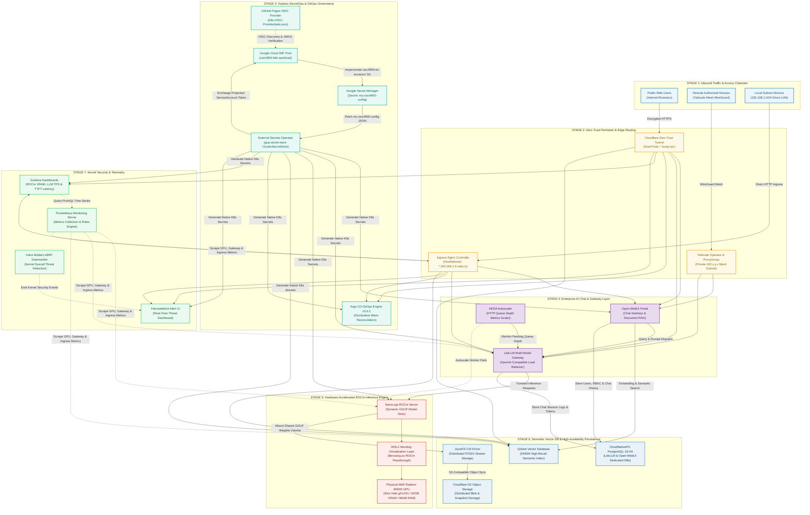

# Cloud-Native Scalable AI Infrastructure
### Enterprise-Grade LLMOps, Zero-Trust GitOps, and AMD ROCm Hardware Accelerated AI Platform

---

## 🎓 Academic Project Information

| Field | Details |
| :--- | :--- |
| **Student Name** | **Suen Ming Kung** |
| **Institution** | **Brooklyn College, The City University of New York (CUNY)** |
| **Course** | **CISC 4900 — Fieldwork in Computer Science / Capstone Project** |
| **Project Title** | **Cloud-Native Scalable AI Infrastructure** |
| **Project Start Date** | **January 10, 2026** |
| **Production Web Portal**| **[https://open-webui.kung.nyc](https://open-webui.kung.nyc)** |
| **Evaluation Credentials** | **Username:** `test@test.com` &nbsp;\|&nbsp; **Password:** `test` *(Account expires in 7 days)* |

<p align="center">
  
  
  
  
  
  
  
  
</p>

---

## 📑 Live Services & Endpoints Registry

| Tier | Service Name | Public Endpoint (Zero Trust) | LAN / Direct Ingress (HTTP) | Internal Cluster DNS | Secret Source / Managed Credentials |
| :--- | :--- | :--- | :--- | :--- | :--- |
| **Frontend** | **Open-WebUI** | [open-webui.kung.nyc](https://open-webui.kung.nyc) | `http://open-webui.192.168.1.3.sslip.io` | `open-webui-svc.open-webui.svc:8080` | Evaluator Account: `test@test.com` / `test` |
| **Gateway** | **LiteLLM Gateway** | [api.kung.nyc](https://api.kung.nyc) | `http://api.192.168.1.3.sslip.io` | `litellm.litellm.svc:4000` | Bearer Token synced via ESO (`my-cisc4900-config`) |
| **Inference**| **llama.cpp ROCm** | *Internal Protected* | *Internal Protected* | `llamacpp-rocm-svc.llamacpp-rocm.svc:8080` | Bearer Token synced via ESO (`my-cisc4900-config`) |
| **Vector DB**| **Qdrant Vector DB** | [qdrant.kung.nyc](https://qdrant.kung.nyc/dashboard) | `http://qdrant.192.168.1.3.sslip.io/dashboard` | `qdrant.qdrant.svc:6333` | Read/Write API Key synced via ESO |
| **GitOps** | **Argo CD** | [argocd.kung.nyc](https://argocd.kung.nyc) | `http://argocd.192.168.1.3.sslip.io` | `argocd-server.argocd.svc:443` | Bcrypt Admin Password synced via ESO |
| **Security** | **Falco Sidekick UI**| [falco.kung.nyc](https://falco.kung.nyc) | `http://falco.192.168.1.3.sslip.io` | `falco-falcosidekick-ui.falco.svc:2801` | Basic Auth synced via ESO (`my-cisc4900-config`) |
| **Monitor** | **Grafana Dashboard**| [grafana.kung.nyc](https://grafana.kung.nyc) | `http://grafana.192.168.1.3.sslip.io` | `lgtm-prometheus-grafana.grafana.svc:80` | Admin credentials synced via ESO |
| **Metrics** | **Prometheus LGTM** | *Internal Protected* | *Internal Protected* | `lgtm-prometheus-kube-prome-prometheus.grafana.svc:9090` | Internal ServiceMonitor scraping endpoints |
| **Mesh VPN** | **Tailscale Operator**| *Tailnet Mesh VIP* | *100.x.y.z subnet* | `tailscale-pg-0.tailscale.svc` | Operator OAuth credentials synced via ESO |

---

## 🌟 Key Architectural Pillars

**Zero-Trust Network Perimeter**
Inbound traffic is secured through dual-replica Cloudflare Zero Trust Tunnels (`*.kung.nyc`) requiring zero open firewall ports or static public IPv4 addresses, combined with high-performance Ingress-Nginx for LAN direct routing (`*.192.168.1.3.sslip.io`) and Tailscale Operator for secure mesh VPN routing.

**Cross-Cloud Keyless SecretOps**
Zero static secrets are committed to Git. Local K3s projected ServiceAccount tokens authenticate against Google Cloud Workload Identity Federation (WIF) using public OIDC keys hosted on GitHub Pages, enabling External Secrets Operator (ESO) to pull all credentials from GCP Secret Manager within Free-Tier limits.

**Declarative GitOps Delivery**
Managed by Argo CD (`v3.6.2`) utilizing Server-Side Apply to continuously reconcile infrastructure, storage, databases, networking, and microservices in declarative, dependency-aware sync waves.

**Hardware-Accelerated Sovereign AI Inference**
Powered by an AMD Radeon 8060S (Strix Halo gfx1151) with 96GB Unified Host RAM and ~62GB shared VRAM. Physical GPU compute is passed through WSL2 via `/dev/dxg` and `librocdxg.so`, running quantized GGUF models on llama.cpp with sub-second token latency.

**Enterprise Multi-Model Gateway**
LiteLLM Gateway acts as an OpenAI-compatible reverse proxy providing intelligent model routing, PostgreSQL-backed session persistence, automated health fallbacks, and token throughput tracking.

**Sub-Millisecond Semantic Vector RAG**
Qdrant Vector Database indexes high-dimensional document embeddings using Hierarchical Navigable Small World (HNSW) graphs, delivering real-time factual context directly into Open-WebUI generation pipelines.

**High-Availability Cloud-Native Storage**
PostgreSQL databases are managed by CloudNativePG operators with automated multi-node replication and failover, while JuiceFS CSI drivers provide POSIX-compliant distributed filesystem storage backed by Cloudflare R2 object storage.

**Kernel-Level Runtime Defense & Observability**
Modern eBPF probes via Falco monitor Linux kernel syscalls in real-time to alert on unauthorized terminal spawns, privilege escalations, and sensitive file reads, integrated into Prometheus & Grafana LGTM visualization stacks.

---

## 🏗️ System Architecture & Data Flow



---

## 📅 Engineering Milestones & Weekly Development Log

The following engineering log details the major milestones and technical hurdles overcome throughout the development lifecycle:

### Week 1 (Jan 10 – Jan 17, 2026): Hardware Virtualization & Direct3D Passthrough
- **Objective**: Establish the host environment on Windows 11 with WSL2 Ubuntu 24.04 and configure hardware passthrough for the AMD Radeon 8060S (Strix Halo APU, architecture `gfx1151`).
- **Challenges**: The Direct3D virtualization device `/dev/dxg` was initially missing inside the WSL2 kernel space due to default virtual machine configuration limits.
- **Resolution**: Configured `/etc/wsl.conf` with `systemd=true`, tuned `.wslconfig` on Windows host with `memory=96GB`, and installed `librocdxg.so` into `/opt/rocm/lib/` to enable native ROCm 6.x compute calls without dedicated PCIe passthrough.

### Week 2 (Jan 18 – Jan 24, 2026): K3s Cluster Initialization & OIDC Issuer Integration
- **Objective**: Deploy a lightweight Kubernetes engine and decouple bundled proxies.
- **Challenges**: Default K3s bundled Traefik conflicted with planned enterprise Nginx Ingress controllers and Cloudflare Tunnels.
- **Resolution**: Deployed K3s with `--disable traefik --write-kubeconfig-mode 644`. Configured `/etc/rancher/k3s/config.yaml` with `--service-account-issuer` targeting the planned public GitHub Pages URL, laying the cryptographic foundation for cross-cloud identity federation.

### Week 3 (Jan 25 – Jan 31, 2026): Ingress-Nginx Direct Binding & Local Wildcard DNS
- **Objective**: Provide high-speed local network access without internet dependency or self-signed certificate warnings.
- **Challenges**: NAT routing inside WSL2 prevented external LAN devices (`192.168.1.0/24`) from reaching cluster service NodePorts.
- **Resolution**: Configured Ingress-Nginx with `controller.hostNetwork=true` and `controller.service.type=ClusterIP`. Leveraged `sslip.io` wildcard DNS resolution (`*.192.168.1.3.sslip.io`), allowing seamless HTTP direct access from any local device without modifying hosts files.

### Week 4 (Feb 01 – Feb 07, 2026): Cloudflare Zero Trust Dual-Replica Tunnel & Ingress Sync
- **Objective**: Expose cluster services to the global internet (`*.kung.nyc`) securely without port forwarding or static public IPs.
- **Challenges**: Single-replica tunnels dropped active WebSocket connections during pod restarts, causing Open-WebUI streaming responses to terminate prematurely.
- **Resolution**: Designed a dual-replica deployment (`cloudflared-tunnel-deployment.yaml`) with Kubernetes anti-affinity rules. Automated tunnel credentials distribution and ingress rules mapping via secret synchronization.

### Week 5 (Feb 08 – Feb 14, 2026): Tailscale Mesh Operator & Private ProxyGroups
- **Objective**: Enable secure, low-latency administrator and developer connectivity from mobile devices and remote laptops.
- **Challenges**: Standard Tailscale containers required Linux host `CAP_NET_ADMIN` privileges that conflicted with Kubernetes security profiles.
- **Resolution**: Implemented the native Tailscale Kubernetes Operator (`tailscale/tailscale-operator`). Defined `ProxyGroup` CRDs that dynamically bridge authorized WireGuard mesh identities directly into cluster clusterIP services.

### Week 6 (Feb 15 – Feb 21, 2026): CloudNativePG PostgreSQL High-Availability Clustering
- **Objective**: Provide enterprise-grade relational database persistence for LiteLLM gateway tokens and Open-WebUI state.
- **Challenges**: Running traditional monolithic PostgreSQL statefulsets lacked automatic failover and required manual volume recovery during node reboots.
- **Resolution**: Deployed CloudNativePG Operator (`v1.25.0`). Defined declarative 2-node HA PostgreSQL clusters (`open-webui-postgres` and `litellm-postgres`) with automated physical streaming replication and automated failover detection.

### Week 7 (Feb 22 – Feb 28, 2026): JuiceFS CSI Driver on Cloudflare R2 Distributed Storage
- **Objective**: Establish shared POSIX storage for distributed AI model checkpoints and database volume backups.
- **Challenges**: Standard NFS drivers suffered high latency over cloud links and lacked native S3 backend compatibility.
- **Resolution**: Configured JuiceFS CSI Driver backed by Cloudflare R2 object storage. Configured a dedicated StorageClass supporting `ReadWriteMany` (RWX) access, enabling multiple worker pods to mount the same model storage simultaneously.

### Week 8 (Mar 01 – Mar 07, 2026): Qdrant Semantic Vector Database & HNSW Tuning
- **Objective**: Integrate a dedicated vector database for high-recall Retrieval-Augmented Generation (RAG).
- **Challenges**: Memory spikes during high-dimensional vector ingestion caused container OOM kills.
- **Resolution**: Deployed Qdrant with custom payload index configurations and HNSW (Hierarchical Navigable Small World) graph tuning. Integrated dedicated Ingress routing for the web management console.

### Week 9 (Mar 08 – Mar 14, 2026): Argo CD GitOps Engine Deployment & CRD Sizing
- **Objective**: Automate continuous synchronization across all 18 infrastructure components.
- **Challenges**: Installing Argo CD via standard `kubectl apply -f` failed with `metadata.annotations: Too long` due to oversized CustomResourceDefinition (CRD) schema sizes.
- **Resolution**: Transitioned deployment commands to use Kubernetes Server-Side Apply (`kubectl apply --server-side --force-conflicts`), bypassing client-side annotation size limits. Configured `argocd.argoproj.io/sync-wave` ordering across all microservice dependencies.

### Week 10 (Mar 15 – Mar 21, 2026): GCP Workload Identity Federation & GitHub Pages OIDC
- **Objective**: Eliminate static JSON service account keys in accordance with Google Cloud security policies (`iam.disableServiceAccountKeyCreation`).
- **Challenges**: Local K3s cluster lacked an externally resolvable HTTPS domain for Google Security Token Service (STS) validation.
- **Resolution**: Extracted cluster OIDC discovery metadata (`openid-configuration` and `jwks.json`) and hosted it on GitHub Pages with `.nojekyll`. Configured Google Cloud WIF Pool (`cisc4900-k8s-workload`) to trust token assertions originating from K3s ServiceAccounts.

### Week 11 (Mar 22 – Mar 28, 2026): External Secrets Operator & Free-Tier Optimization
- **Objective**: Automate credential synchronization directly into Kubernetes secrets without committing sensitive values to Git.
- **Challenges**: Creating individual secrets in Google Secret Manager risked exceeding GCP's free tier (max 6 active secret versions and 10,000 monthly access calls).
- **Resolution**: Consolidated all 29 system credentials into a single JSON secret (`my-cisc4900-config`). Configured External Secrets Operator templates to parse individual properties, preserving 100% free-tier compliance while maintaining secret rotation.

### Week 12 (Mar 29 – Apr 04, 2026): Falco Modern eBPF Kernel Threat Monitoring
- **Objective**: Protect the cluster against container escapes and runtime attack vectors.
- **Challenges**: WSL2 kernels do not support traditional kernel module compilation (`falco-bpf.o`), causing standard Falco containers to fail startup.
- **Resolution**: Deployed Falco with the `modern_ebpf` engine, which requires no external kernel headers. Increased system `fs.inotify.max_user_instances` and `fs.inotify.max_user_watches` parameters to prevent probe exhaustion.

### Week 13 (Apr 05 – Apr 11, 2026): LGTM Observability Stack & Custom GPU Dashboards
- **Objective**: Implement comprehensive Prometheus metrics scraping and Grafana dashboard visualization.
- **Challenges**: Prometheus Community Helm chart did not include out-of-the-box telemetry for AMD ROCm GPU compute utilization or llama.cpp token queues.
- **Resolution**: Configured custom Prometheus ServiceMonitors targeting llama.cpp and LiteLLM metric endpoints. Built a dedicated ConfigMap dashboard (`3-Grafana-LLaMAcpp-ROCm.yaml`) tracking VRAM allocation, Tokens Per Second (TPS), and Time-To-First-Token (TTFT).

### Week 14 (Apr 12 – Apr 18, 2026): llama.cpp ROCm GPU Inference Engine & Dynamic Models
- **Objective**: Deploy high-throughput local LLM serving with hardware acceleration.
- **Challenges**: Baking massive GGUF weights into container images resulted in 50GB+ images that were slow to deploy and update.
- **Resolution**: Decoupled weights from containers by creating persistent volume claims mounting host model directories. Configured dynamic symlinks under `/gguf` and optimized llama.cpp parameters (`--n-gpu-layers 999`, `--ctx-size 32768`, `--parallel 4`).

### Week 15 (Apr 19 – Apr 25, 2026): LiteLLM Gateway & KEDA Queue Autoscaling
- **Objective**: Provide an OpenAI-compatible routing gateway with dynamic pod autoscaling based on traffic.
- **Challenges**: High concurrent loads resulted in request timeouts when all inference slots on a single pod were saturated.
- **Resolution**: Integrated LiteLLM Gateway backed by CloudNativePG for session logging and token tracking. Deployed KEDA `ScaledObject` monitors tracking pending HTTP queue depth, automatically scaling llama.cpp worker pods dynamically under load.

### Week 16 (Apr 26 – May 02, 2026): Open-WebUI Enterprise Portal & Verification Suite
- **Objective**: Deliver a polished user experience and validate the entire platform against enterprise security baselines.
- **Challenges**: Ensuring all components remain synchronized and automated tests execute reliably without human intervention.
- **Resolution**: Deployed Open-WebUI connected to LiteLLM and Qdrant. Built an automated 10-tier verification pipeline (`101` through `110`) covering end-to-end inference, OWASP Top 10 LLM security, NetworkPolicy micro-segmentation, and database failover.

---

## 🗂️ Repository Structure & File Tree

<pre>
<b>Cloud-Native_LLMOps_Infrastructure/</b>
│
├── <b>00-Installation-Testing/</b>              # Centralized Management Console & Verification Pipeline
│   ├── <a href="file:///e:/CISC4900/00-Installation-Testing/Copy-SSH.bat">Copy-SSH.bat</a>                  # Silent Windows batch script synchronizing all manifests via SCP
│   ├── <a href="file:///e:/CISC4900/00-Installation-Testing/00-Menu.sh">00-Menu.sh</a>                    # Interactive 4-column master CLI control center (Steps 0~18 & 100~110)
│   ├── 01-Hardware-OS-Configuration.sh   # Configures system limits, inotify watches, /etc/wsl.conf and packages
│   ├── 02-AMD-ROCm-DXG.sh                # Verifies /dev/dxg, links librocdxg.so, and tests ROCm diagnostic pod
│   ├── 03-Kubernetes.sh                  # Installs K3s, configures OIDC Issuer flag, and sets up kubeconfig
│   ├── 04-Helm.sh                        # Installs Helm 3 package manager and registers 9 community repositories
│   ├── 05-External-Secrets-Operator.sh   # Sets up GCP WIF credentials, deploys ESO, and verifies ClusterSecretStore
│   ├── 06-Tailscale-Operator.sh          # Deploys Tailscale Operator, applies ProxyGroup, and configures OAuth
│   ├── 07-Cloudflare-Tunnel.sh           # Deploys dual-replica cloudflared tunnel, ServiceAccount, and RBAC
│   ├── 08-Ingress-Nginx.sh               # Deploys Ingress-Nginx controller with hostNetwork direct port binding
│   ├── 09-JuiceFS-CSI-Driver.sh          # Installs JuiceFS CSI driver, creates StorageClass with Cloudflare R2
│   ├── 10-CloudNativePG-DB.sh            # Deploys CloudNativePG operator for high-availability PostgreSQL
│   ├── 11-Qdrant-Vector-DB.sh            # Deploys Qdrant semantic vector database and exposes Web UI Ingress
│   ├── 12-ArgoCD-GitOps.sh               # Deploys Argo CD v3.6.2 using Server-Side Apply and synchronizes admin secret
│   ├── 13-Falco-Security.sh              # Installs Falco with modern eBPF driver and Sidekick threat dashboard
│   ├── 14-Grafana-Prometheus-Stack.sh    # Deploys Prometheus & Grafana LGTM stack with ROCm GPU dashboards
│   ├── 15-KEDA-Autoscaler.sh             # Deploys KEDA event-driven autoscaler and configures ScaledObject
│   ├── 16-LLaMAcpp-ROCm.sh               # Deploys llama.cpp ROCm GPU server mounting dynamic GGUF weight volumes
│   ├── 17-LiteLLM-Gateway.sh             # Deploys LiteLLM gateway, ConfigMap catalog, and dedicated CNPG database
│   ├── 18-Open-WebUI.sh                  # Deploys Open-WebUI enterprise portal, RAG bindings, and dedicated CNPG database
│   ├── 100-Download-LLM.sh               # High-speed model downloader with multi-threaded aria2c acceleration
│   ├── 101-Test-AI-Stack-E2E.sh          # [Test 101] Validates complete loop: Qdrant -> llama -> LiteLLM -> OpenWebUI
│   ├── 102-Test-Security-Penetration.sh  # [Test 102] Validates NetworkPolicy isolation and Falco eBPF threat alerts
│   ├── 103-Test-RAG-Benchmark.sh         # [Test 103] Tests vector ingestion, HNSW semantic recall, and closed-loop QA
│   ├── 104-Test-Concurrency-Throughput.sh# [Test 104] Multi-user concurrent load test measuring TPS, TTFT, and KEDA scaling
│   ├── 105-Test-Context-Stress.sh        # [Test 105] Stepped context stress test (1K~32K) monitoring VRAM and KV cache
│   ├── 106-Test-Needle-In-Haystack.sh    # [Test 106] 32K context Needle-In-A-Haystack precision memory retrieval test
│   ├── 107-Test-LLM-Guardrails-OWASP.sh  # [Test 107] OWASP Top 10 for LLM security audit (injection, jailbreak, leakage)
│   ├── 108-Test-Cluster-Security-Audit.sh# [Test 108] K8s RBAC least-privilege, Pod Security Standards, and secret isolation
│   ├── 109-Test-Storage-Persistence-Failover.sh # [Test 109] Storage persistence, PostgreSQL failover, and pod self-healing
│   └── 110-Test-LLM-CLI.sh               # [Test 110] Interactive multi-turn CLI chatbot with dynamic model selection
│
├── <b>01-Hardware-OS-Configuration/</b>         # Host Operating System & User Environment Configurations
│   ├── .bashrc                           # User shell environment exporting KUBECONFIG and cluster CLI shortcuts
│   ├── wsl.conf                          # WSL2 settings enforcing systemd init, metadata mounting, and network config
│   └── .cloudflared/                     # Cloudflare Zero Trust tunnel credentials and hostname routing config
│
├── <b>02-AMD-ROCm-DXG/</b>                      # AMD Hardware Acceleration & Diagnostics
│   ├── 1-AMD-ROCDXG-Namespace.yaml       # Dedicated namespace manifest for ROCm diagnostic workloads
│   └── 2-AMD-ROCDXG-Deployment.yaml      # ROCm diagnostic pod mounting /dev/dxg and testing librocdxg.so
│
├── <b>03-Kubernetes/</b>                        # K3s Kubernetes Engine Core Configurations
│   ├── config.yaml                       # K3s API Server configuration declaring the public OIDC Issuer URL
│   └── k3s.yaml                          # Master Kubeconfig with cluster certificates and 0644 read permissions
│
├── <b>04-Helm/</b>                              # Kubernetes Package Management
│   └── init-helm-repos.sh                # Registers 9 official repositories (Prometheus, Falco, Tailscale, etc.)
│
├── <b>05-External-Secrets-Operator/</b>         # Cross-Cloud Keyless Identity & Secret Synchronization
│   ├── 1-External-Secrets-Namespace.yaml # external-secrets namespace manifest
│   ├── Google-Cloud-Platform-CSS.yaml    # ClusterSecretStore declaring integration with Google Secret Manager
│   └── wif-credentials.json              # WIF client library configuration mapping to GitHub Pages OIDC provider
│
├── <b>06-Tailscale-Operator/</b>                # Secure WireGuard Mesh VPN Networking
│   ├── 1-Tailscale-Namespace.yaml        # tailscale namespace manifest
│   ├── 2-Tailscale-ProxyGroup.yaml       # ProxyGroup CRD routing authorized tailnet traffic to cluster services
│   └── My-Tailscale-ExternalSecret.yaml  # ExternalSecret extracting Tailscale OAuth client credentials from GCP
│
├── <b>07-Cloudflare-Tunnel/</b>                 # Zero Trust Edge Ingress Perimeter
│   ├── 1-Cloudflare-KV-Namespace.yaml    # cloudflare-kv namespace manifest
│   ├── 2-Cloudflare-KV-ServiceAccount.yaml# Dedicated ServiceAccount for tunnel manager pod
│   ├── 3-Cloudflare-KV-RBAC.yaml         # RBAC Role granting pod and secret read capabilities
│   ├── 4-Cloudflare-KV-RoleBinding.yaml  # RoleBinding binding tunnel Role to ServiceAccount
│   ├── 5-Cloudflare-ES-RBAC.yaml         # RBAC definitions allowing ESO access in cloudflare namespace
│   ├── 6-Cloudflare-ES-RoleBinding.yaml  # RoleBinding binding ESO permissions in cloudflare namespace
│   ├── 7-Cloudflare-KV-CronJob.yaml      # CronJob synchronizing dynamic DNS records with Cloudflare KV
│   ├── 8-Cloudflared-Tunnel-Deployment.yaml # High-Availability dual-replica cloudflared tunnel deployment
│   └── My-Cloudflare-ExternalSecret.yaml # ExternalSecret extracting Cloudflare Account ID and API Tokens
│
├── <b>08-Ingress-Nginx/</b>                     # High-Performance Local Ingress Routing
│   └── 1-Ingress-Nginx-Namespace.yaml    # ingress-nginx namespace manifest
│
├── <b>09-JuiceFS-CSI-Driver/</b>                # Distributed POSIX File Storage
│   ├── 1-Cloudflare-JuiceFS-StorageClass.yaml # StorageClass defining JuiceFS volumes backed by Cloudflare R2
│   ├── 2-Cloudflare-JuiceFS-Postgres.yaml# PersistentVolumeClaim for shared database snapshots and backups
│   └── My-Cloudflare-JuiceFS-ExternalSecret.yaml # ExternalSecret extracting JuiceFS format keys and R2 tokens
│
├── <b>10-CloudNativePG-DB/</b>                  # High-Availability PostgreSQL Database Operator
│   ├── 1-CloudNativePG-Namespace.yaml    # cnpg-system namespace manifest
│   └── 2-CloudNativePG-Operator.yaml     # CloudNativePG v1.25.0 operator deployment and CRD definitions
│
├── <b>11-Qdrant-Vector-DB/</b>                  # Semantic Vector Search Engine
│   ├── 1-Qdrant-Namespace.yaml           # qdrant namespace manifest
│   ├── 2-Qdrant-Ingress.yaml             # Ingress exposing Qdrant Dashboard and REST API over SSL and LAN
│   └── My-Qdrant-ExternalSecret.yaml     # ExternalSecret extracting Qdrant Read/Write & Read-Only API Keys
│
├── <b>12-ArgoCD-GitOps/</b>                     # Declarative Continuous Delivery Engine
│   ├── 1-ArgoCD-Namespace.yaml           # argocd namespace manifest
│   ├── 2-ArgoCD-Ingress.yaml             # Ingress exposing Argo CD Web UI with SSL Passthrough
│   ├── 3-ArgoCD-Install.yaml             # Argo CD v3.6.2 complete official distribution manifest
│   ├── ArgoCD-App-External-Secrets.yaml  # Argo CD Application manifest managing External Secrets Operator
│   └── My-ArgoCD-ExternalSecret.yaml     # ExternalSecret synchronizing and merging Bcrypt admin password
│
├── <b>13-Falco-Security/</b>                    # Runtime eBPF Threat Monitoring
│   ├── 1-Falco-Namespace.yaml            # falco namespace manifest
│   ├── 2-Falco-Ingress.yaml              # Ingress exposing Falcosidekick Web UI over SSL and LAN
│   ├── My-Falco-Config.yaml              # Helm values configuring modern eBPF driver and existingSecret
│   └── My-Falco-ExternalSecret.yaml      # ExternalSecret extracting Falcosidekick Web UI credentials
│
├── <b>14-Grafana-Prometheus-Stack/</b>          # LGTM Metrics & Observability Stack
│   ├── 1-Grafana-Namespace.yaml          # grafana namespace manifest
│   ├── 2-Grafana-Ingress.yaml            # Ingress exposing Grafana dashboard over SSL and LAN
│   ├── 3-Grafana-LLaMAcpp-ROCm.yaml      # Dedicated ConfigMap dashboard visualizing ROCm GPU and LLM TPS
│   ├── My-Grafana-Config.yaml            # Helm values configuring admin credentials and dashboard providers
│   └── My-Grafana-ExternalSecret.yaml    # ExternalSecret extracting Grafana admin password from GCP
│
├── <b>15-KEDA-Autoscaler/</b>                   # Event-Driven Pod Autoscaler
│   └── 1-LLaMAcpp-KEDA-ScaledObject.yaml # ScaledObject scaling llama.cpp based on pending HTTP queue depth
│
├── <b>16-LLaMAcpp-ROCm/</b>                     # Hardware-Accelerated ROCm GPU Inference Server
│   ├── 1-LLaMAcpp-Namespace.yaml         # llamacpp-rocm namespace manifest
│   ├── 2-LLaMAcpp-PersistentVolumeClaim.yaml # PVC mounting HuggingFace GGUF models storage volume
│   ├── 3-LLaMAcpp-Deployment.yaml        # Deployment mounting /dev/dxg, librocdxg, and model weights
│   ├── 4-LLaMAcpp-Service.yaml           # ClusterIP Service exposing OpenAI-compatible endpoints on port 8080
│   ├── 5-LLaMAcpp-ServiceMonitor.yaml    # Prometheus ServiceMonitor scraping inference performance metrics
│   ├── 6-LLaMAcpp-NetworkPolicy.yaml     # NetworkPolicy restricting ingress traffic exclusively to LiteLLM
│   └── My-LLaMAcpp-ExternalSecret.yaml   # ExternalSecret extracting internal Bearer Token from GCP
│
├── <b>17-LiteLLM-Gateway/</b>                   # Multi-Model AI Routing & Accounting Gateway
│   ├── 1-LiteLLM-Namespace.yaml          # litellm namespace manifest
│   ├── 2-LiteLLM-Postgres-Cluster.yaml   # CloudNativePG 2-node HA PostgreSQL cluster for LiteLLM
│   ├── 3-LiteLLM-Deployment.yaml         # Deployment with multi-model routing, load balancing, and DB pooling
│   ├── 4-LiteLLM-Service.yaml            # ClusterIP Service exposing port 4000
│   ├── 5-LiteLLM-ServiceMonitor.yaml     # Prometheus ServiceMonitor tracking TPS, latency, and token metrics
│   ├── 6-LiteLLM-NetworkPolicy.yaml      # NetworkPolicy restricting ingress traffic to Open-WebUI & Ingress
│   ├── 7-LiteLLM-Ingress.yaml            # Ingress exposing public API endpoint at api.kung.nyc
│   ├── My-LiteLLM-Config.yaml            # Model catalog ConfigMap declaring Gemma 4, Qwen 3.6, and Muse
│   └── My-LiteLLM-ExternalSecret.yaml    # ExternalSecret extracting Master API Key and PostgreSQL credentials
│
├── <b>18-Open-WebUI/</b>                        # Production Generative AI Chat Portal
│   ├── 1-OpenWebUI-Namespace.yaml        # open-webui namespace manifest
│   ├── 2-OpenWebUI-Postgres-Cluster.yaml # CloudNativePG 2-node HA PostgreSQL cluster for Open-WebUI
│   ├── 3-OpenWebUI-Deployment.yaml       # Deployment configured with LiteLLM proxy and Qdrant RAG endpoints
│   ├── 4-OpenWebUI-Service.yaml          # ClusterIP Service exposing port 8080
│   ├── 5-OpenWebUI-NetworkPolicy.yaml    # NetworkPolicy enforcing strict namespace isolation
│   ├── 6-Open-WebUI-Ingress.yaml         # Ingress exposing portal at open-webui.kung.nyc and sslip.io
│   ├── My-OpenWebUI-Config.yaml          # Portal configuration, branding, and feature toggles
│   └── My-OpenWebUI-ExternalSecret.yaml  # ExternalSecret extracting JWT secret, DB password, and Qdrant keys
│
├── <b>K8s-OIDC-Provider/</b>                    # Public RFC 8414 OIDC Cryptographic Endpoints (GitHub Pages)
│   ├── .well-known/
│   │   └── openid-configuration          # Public OIDC discovery document listing issuer and JWKS URI
│   └── jwks.json                         # Public JSON Web Key Set matching K3s service account signing keys
│
└── <b>Operations Runbooks:</b>
    ├── (0)Installation-Testing.txt       # Master automated menu and validation guide
    ├── (1)Hardware-OS-Configuration.txt  # Host OS setup, kernel parameters, and inotify tuning runbook
    ├── (2)AMD-ROCm-DXG.txt               # AMD Strix Halo GPU virtualization & driver verification runbook
    ├── (3)Kubernetes.txt                 # K3s cluster installation and OIDC configuration runbook
    ├── (4)Helm.txt                       # Helm 3 setup and repository configuration runbook
    ├── (5)External-Secrets-Operator.txt  # GCP WIF and ESO 6-stage disaster recovery runbook
    ├── (6)Tailscale-Operator.txt         # Tailscale mesh VPN setup and proxy group runbook
    ├── (7)Cloudflare-Tunnel.txt          # Cloudflare Zero Trust dual-replica tunnel runbook
    ├── (8)Ingress-Nginx.txt              # Ingress-Nginx controller setup and hostNetwork runbook
    ├── (9)JuiceFS-CSI-Driver.txt         # Distributed POSIX JuiceFS storage setup runbook
    ├── (10)CloudNativePG-DB.txt          # High-Availability PostgreSQL operator runbook
    ├── (11)Qdrant-Vector-DB.txt          # Qdrant semantic vector database setup runbook
    ├── (12)ArgoCD-GitOps.txt             # Argo CD GitOps continuous delivery runbook
    ├── (13)Falco-Security.txt            # Falco modern eBPF threat monitoring setup runbook
    ├── (14)Grafana-Prometheus-Stack.txt  # Prometheus & Grafana LGTM stack setup runbook
    ├── (15)KEDA-Autoscaler.txt           # KEDA event-driven autoscaling runbook
    ├── (16)LLaMAcpp-ROCm.txt             # llama.cpp ROCm GPU inference engine runbook
    ├── (17)LiteLLM-Gateway.txt           # LiteLLM multi-model gateway & database runbook
    └── (18)Open-WebUI.txt                # Open-WebUI enterprise portal & RAG setup runbook
</pre>

---

## ⚙️ Enterprise Infrastructure Components

### 1. Hardware Virtualization & OS Configuration Layer
- **Component Directories**: `01-Hardware-OS-Configuration`, `02-AMD-ROCm-DXG`
- **Architectural Role**: Configures host OS parameters, tunes kernel sysctl limits, and maps the physical AMD Radeon 8060S GPU (`gfx1151`) into WSL2 user space via `/dev/dxg` and `librocdxg.so`.
- **Key Advantages**:
  - Unlocks 62GB of unified VRAM, enabling local inference of 30B+ parameter models on consumer hardware.
  - Expands Linux inotify limits (`fs.inotify.max_user_watches=1048576`), preventing eBPF probes from exhausting filesystem notification descriptors.
- **File Storage Locations & Key Manifests**:
  - `E:\CISC4900\01-Hardware-OS-Configuration\wsl.conf` &rarr; Copied to `/etc/wsl.conf` (Stores systemd init flags, automount settings, and DNS resolution rules).
  - `E:\CISC4900\01-Hardware-OS-Configuration\.bashrc` &rarr; Copied to `~/.bashrc` (Stores user environment variables including `KUBECONFIG`).
  - `E:\CISC4900\02-AMD-ROCm-DXG\2-AMD-ROCDXG-Deployment.yaml` &rarr; Target namespace `amd-rocdxg` (Mounts `/dev/dxg` device into containers).
- **Original Underlying Installation Commands**:
  ```bash
  # 1. Install system utilities and configure inotify limits
  sudo cp ~/01-Hardware-OS-Configuration/wsl.conf /etc/wsl.conf && sudo chmod 644 /etc/wsl.conf
  cp ~/01-Hardware-OS-Configuration/.bashrc ~/.bashrc
  sudo apt-get update -y && sudo apt-get install -y curl wget jq git ca-certificates gnupg openssh-server aria2
  echo "fs.inotify.max_user_instances=8192" | sudo tee /etc/sysctl.d/99-inotify.conf
  echo "fs.inotify.max_user_watches=1048576" | sudo tee -a /etc/sysctl.d/99-inotify.conf
  sudo sysctl -p /etc/sysctl.d/99-inotify.conf

  # 2. Configure ROCm DXG virtualization library and diagnostic pod
  sudo mkdir -p /opt/rocm/lib
  if [ -f "/usr/lib/librocdxg.so" ]; then sudo ln -sf /usr/lib/librocdxg.so /opt/rocm/lib/librocdxg.so; fi
  kubectl apply -f ~/02-AMD-ROCm-DXG/1-AMD-ROCDXG-Namespace.yaml
  kubectl apply -f ~/02-AMD-ROCm-DXG/2-AMD-ROCDXG-Deployment.yaml
  ```

---

### 2. Kubernetes Core Cluster Layer
- **Component Directories**: `03-Kubernetes`, `04-Helm`
- **Architectural Role**: Deploys lightweight K3s (`v1.37.2+k3s1`) with Containerd and Flannel CNI, configured with a public OIDC Issuer parameter for Google Cloud Workload Identity Federation.
- **Key Advantages**:
  - Minimal system overhead compared to standard kubeadm distributions.
  - Native `--service-account-issuer` integration allows K3s ServiceAccount tokens to be verified by external cloud providers without static credentials.
- **File Storage Locations & Key Manifests**:
  - `E:\CISC4900\03-Kubernetes\config.yaml` &rarr; Copied to `/etc/rancher/k3s/config.yaml` (Stores `write-kubeconfig-mode: "0644"` and `service-account-issuer` URL).
  - `E:\CISC4900\03-Kubernetes\k3s.yaml` &rarr; Copied to `/etc/rancher/k3s/k3s.yaml` and `~/.kube/config` (Stores cluster certificates and connection endpoints).
- **Original Underlying Installation Commands**:
  ```bash
  # 1. Install K3s API server configuration declaring public OIDC Issuer
  sudo mkdir -p /etc/rancher/k3s
  sudo cp ~/03-Kubernetes/config.yaml /etc/rancher/k3s/config.yaml

  # 2. Install K3s with Traefik disabled
  curl -sfL https://get.k3s.io | INSTALL_K3S_EXEC="--disable traefik --write-kubeconfig-mode 644" sh -

  # 3. Configure Kubeconfig environment
  mkdir -p ~/.kube
  sudo cp /etc/rancher/k3s/k3s.yaml ~/.kube/config
  sudo chown $(id -u):$(id -g) ~/.kube/config && chmod 600 ~/.kube/config
  export KUBECONFIG="$HOME/.kube/config"

  # 4. Install Helm 3 and initialize official chart repositories
  curl -fsSL https://raw.githubusercontent.com/helm/helm/main/scripts/get-helm-3 | bash
  chmod +x ~/04-Helm/init-helm-repos.sh && bash ~/04-Helm/init-helm-repos.sh
  ```

---

### 3. Cross-Cloud Keyless SecretOps & GitOps Layer
- **Component Directories**: `05-External-Secrets-Operator`, `12-ArgoCD-GitOps`, `K8s-OIDC-Provider`
- **Architectural Role**: Implements Zero-Trust credential management using Google Cloud Workload Identity Federation (WIF) and Argo CD GitOps continuous delivery.
- **Key Advantages**:
  - Eliminates plaintext credentials across all repositories.
  - Restricts GCP Secret Manager usage to a single versioned secret (`my-cisc4900-config`), remaining 100% within free-tier quotas.
  - Server-Side Apply allows Argo CD to manage oversized CRD manifests seamlessly.
- **File Storage Locations & Key Manifests**:
  - `E:\CISC4900\05-External-Secrets-Operator\wif-credentials.json` &rarr; Stored in `external-secrets` namespace as secret `gcp-wif-config` (Holds STS WIF audience and provider mapping).
  - `E:\CISC4900\05-External-Secrets-Operator\Google-Cloud-Platform-CSS.yaml` &rarr; Global `ClusterSecretStore` named `gcp-secret-store`.
  - `E:\CISC4900\12-ArgoCD-GitOps\3-ArgoCD-Install.yaml` &rarr; Deployed to `argocd` namespace (Official Argo CD v3.6.2 distribution).
- **Original Underlying Installation Commands**:
  ```bash
  # 1. Create external-secrets namespace and mount WIF credentials secret
  kubectl apply -f ~/05-External-Secrets-Operator/1-External-Secrets-Namespace.yaml
  kubectl create secret generic gcp-wif-config \
    --from-file=config=$HOME/05-External-Secrets-Operator/wif-credentials.json \
    -n external-secrets --dry-run=client -o yaml | kubectl apply -f -

  # 2. Deploy External Secrets Operator via Helm with Projected Token volume mounts
  helm upgrade --install external-secrets external-secrets/external-secrets \
    -n external-secrets --create-namespace \
    --set installCRDs=true \
    --set extraVolumes[0].name=gcp-wif-config \
    --set extraVolumes[0].secret.secretName=gcp-wif-config \
    --set extraVolumes[1].name=k8s-oidc-token \
    --set "extraVolumes[1].projected.sources[0].serviceAccountToken.path=token" \
    --set "extraVolumes[1].projected.sources[0].serviceAccountToken.expirationSeconds=3600" \
    --set "extraVolumes[1].projected.sources[0].serviceAccountToken.audience=//iam.googleapis.com/projects/449506712476/locations/global/workloadIdentityPools/cisc4900-k8s-workload/providers/github-oidc-provider" \
    --set extraVolumeMounts[0].name=gcp-wif-config \
    --set extraVolumeMounts[0].mountPath=/var/run/secrets/gcp-wif \
    --set extraVolumeMounts[1].name=k8s-oidc-token \
    --set extraVolumeMounts[1].mountPath=/var/run/secrets/k8s-oidc \
    --set extraEnv[0].name=GOOGLE_APPLICATION_CREDENTIALS \
    --set extraEnv[0].value=/var/run/secrets/gcp-wif/config

  # 3. Apply Google Cloud ClusterSecretStore
  kubectl apply -f ~/05-External-Secrets-Operator/Google-Cloud-Platform-CSS.yaml

  # 4. Deploy Argo CD using Server-Side Apply
  kubectl apply -f ~/12-ArgoCD-GitOps/1-ArgoCD-Namespace.yaml
  kubectl apply -f ~/12-ArgoCD-GitOps/My-ArgoCD-ExternalSecret.yaml
  kubectl apply --server-side --force-conflicts -n argocd -f ~/12-ArgoCD-GitOps/3-ArgoCD-Install.yaml
  kubectl apply -f ~/12-ArgoCD-GitOps/2-ArgoCD-Ingress.yaml
  ```

---

### 4. Zero-Trust Network Perimeter & Edge Ingress Layer
- **Component Directories**: `06-Tailscale-Operator`, `07-Cloudflare-Tunnel`, `08-Ingress-Nginx`
- **Architectural Role**: Forms a triple-channel ingress architecture securing public internet (`*.kung.nyc`), private WireGuard mesh VPN, and direct local LAN traffic (`*.192.168.1.3.sslip.io`).
- **Key Advantages**:
  - Dual-replica Cloudflare tunnels maintain persistent outbound connections without exposing open firewall ports.
  - Ingress-Nginx bound to host networking guarantees full-speed unthrottled LAN access.
- **File Storage Locations & Key Manifests**:
  - `E:\CISC4900\01-Hardware-OS-Configuration\.cloudflared\` &rarr; Copied to `~/.cloudflared/` (Stores tunnel credential JSON and ingress mapping rules).
  - `E:\CISC4900\07-Cloudflare-Tunnel\8-Cloudflared-Tunnel-Deployment.yaml` &rarr; Deployed to `cloudflare-kv` namespace.
  - `E:\CISC4900\06-Tailscale-Operator\2-Tailscale-ProxyGroup.yaml` &rarr; Deployed to `tailscale` namespace.
- **Original Underlying Installation Commands**:
  ```bash
  # 1. Deploy Tailscale Operator
  kubectl apply -f ~/06-Tailscale-Operator/1-Tailscale-Namespace.yaml
  kubectl apply -f ~/06-Tailscale-Operator/My-Tailscale-ExternalSecret.yaml
  helm upgrade --install tailscale-operator tailscale/tailscale-operator \
    -n tailscale --create-namespace --set oauth.secret=operator-oauth
  kubectl apply -f ~/06-Tailscale-Operator/2-Tailscale-ProxyGroup.yaml

  # 2. Deploy Cloudflare Tunnel
  kubectl apply -f ~/07-Cloudflare-Tunnel/1-Cloudflare-KV-Namespace.yaml
  kubectl apply -f ~/07-Cloudflare-Tunnel/My-Cloudflare-ExternalSecret.yaml
  kubectl apply -f ~/07-Cloudflare-Tunnel/2-Cloudflare-KV-ServiceAccount.yaml
  kubectl apply -f ~/07-Cloudflare-Tunnel/3-Cloudflare-KV-RBAC.yaml
  kubectl apply -f ~/07-Cloudflare-Tunnel/4-Cloudflare-KV-RoleBinding.yaml
  kubectl apply -f ~/07-Cloudflare-Tunnel/5-Cloudflare-ES-RBAC.yaml
  kubectl apply -f ~/07-Cloudflare-Tunnel/6-Cloudflare-ES-RoleBinding.yaml
  kubectl apply -f ~/07-Cloudflare-Tunnel/7-Cloudflare-KV-CronJob.yaml
  kubectl apply -f ~/07-Cloudflare-Tunnel/8-Cloudflared-Tunnel-Deployment.yaml

  # 3. Deploy Ingress-Nginx with hostNetwork binding
  kubectl apply -f ~/08-Ingress-Nginx/1-Ingress-Nginx-Namespace.yaml
  helm upgrade --install ingress-nginx ingress-nginx/ingress-nginx \
    -n ingress-nginx --create-namespace \
    --set controller.service.type=ClusterIP \
    --set controller.hostNetwork=true
  ```

---

### 5. Cloud-Native Distributed Storage & Database Layer
- **Component Directories**: `09-JuiceFS-CSI-Driver`, `10-CloudNativePG-DB`
- **Architectural Role**: Provides distributed POSIX filesystem storage backed by Cloudflare R2 and declarative high-availability PostgreSQL clusters.
- **Key Advantages**:
  - JuiceFS enables multi-pod read-write access (`RWX`) for shared model weights without data corruption.
  - CloudNativePG provides automated primary-standby replication and sub-minute failover.
- **File Storage Locations & Key Manifests**:
  - `E:\CISC4900\09-JuiceFS-CSI-Driver\1-Cloudflare-JuiceFS-StorageClass.yaml` &rarr; Cluster StorageClass `juicefs-r2-sc`.
  - `E:\CISC4900\10-CloudNativePG-DB\2-CloudNativePG-Operator.yaml` &rarr; Deployed to `cnpg-system` namespace.
- **Original Underlying Installation Commands**:
  ```bash
  # 1. Deploy JuiceFS CSI Driver
  sudo mount --make-shared /
  helm upgrade --install juicefs-csi-driver juicefs/juicefs-csi-driver -n kube-system
  kubectl apply -f ~/09-JuiceFS-CSI-Driver/My-Cloudflare-JuiceFS-ExternalSecret.yaml
  kubectl apply -f ~/09-JuiceFS-CSI-Driver/1-Cloudflare-JuiceFS-StorageClass.yaml
  kubectl apply -f ~/09-JuiceFS-CSI-Driver/2-Cloudflare-JuiceFS-Postgres.yaml

  # 2. Deploy CloudNativePG Operator
  kubectl apply -f ~/10-CloudNativePG-DB/1-CloudNativePG-Namespace.yaml
  kubectl apply --server-side -f ~/10-CloudNativePG-DB/2-CloudNativePG-Operator.yaml
  ```

---

### 6. Semantic Vector Search Layer
- **Component Directory**: `11-Qdrant-Vector-DB`
- **Architectural Role**: High-performance semantic vector database managing document embeddings for Open-WebUI's RAG pipeline.
- **Key Advantages**:
  - Sub-millisecond HNSW vector search indexing with fine-grained collection-level payload filtering.
- **File Storage Locations & Key Manifests**:
  - `E:\CISC4900\11-Qdrant-Vector-DB\2-Qdrant-Ingress.yaml` &rarr; Target namespace `qdrant` (Exposes dashboard at `qdrant.kung.nyc` and REST on port 6333).
- **Original Underlying Installation Commands**:
  ```bash
  kubectl apply -f ~/11-Qdrant-Vector-DB/1-Qdrant-Namespace.yaml
  kubectl apply -f ~/11-Qdrant-Vector-DB/My-Qdrant-ExternalSecret.yaml
  helm upgrade --install qdrant qdrant/qdrant \
    -n qdrant --create-namespace \
    --set persistence.size=20Gi \
    --set apiKey.existingSecret=my-qdrant-config \
    --set apiKey.existingSecretKey=api-key
  kubectl apply -f ~/11-Qdrant-Vector-DB/2-Qdrant-Ingress.yaml
  ```

---

### 7. Runtime Kernel Security & Observability Layer
- **Component Directories**: `13-Falco-Security`, `14-Grafana-Prometheus-Stack`
- **Architectural Role**: Real-time eBPF kernel threat monitoring and Prometheus/Grafana LGTM telemetry stack.
- **Key Advantages**:
  - Non-invasive kernel-level security detection alerting immediately on abnormal shell spawns or file reads.
  - Dedicated Grafana dashboard visualizing AMD ROCm VRAM usage, inference queue depth, and TTFT latency.
- **File Storage Locations & Key Manifests**:
  - `E:\CISC4900\13-Falco-Security\My-Falco-Config.yaml` &rarr; Helm values setting `driver.kind: modern_ebpf` and referencing `falco-falcosidekick-ui-secret`.
  - `E:\CISC4900\14-Grafana-Prometheus-Stack\3-Grafana-LLaMAcpp-ROCm.yaml` &rarr; ConfigMap containing the full Grafana dashboard JSON.
- **Original Underlying Installation Commands**:
  ```bash
  # 1. Deploy Falco with modern eBPF driver
  kubectl apply -f ~/13-Falco-Security/1-Falco-Namespace.yaml
  kubectl apply -f ~/13-Falco-Security/My-Falco-ExternalSecret.yaml
  helm upgrade --install falco falcosecurity/falco \
    -n falco --create-namespace \
    -f ~/13-Falco-Security/My-Falco-Config.yaml
  kubectl apply -f ~/13-Falco-Security/2-Falco-Ingress.yaml

  # 2. Deploy Prometheus & Grafana LGTM Stack
  kubectl apply -f ~/14-Grafana-Prometheus-Stack/1-Grafana-Namespace.yaml
  kubectl apply -f ~/14-Grafana-Prometheus-Stack/My-Grafana-ExternalSecret.yaml
  helm upgrade --install lgtm-prometheus prometheus-community/kube-prometheus-stack \
    -n grafana --create-namespace \
    --set grafana.enabled=true \
    -f ~/14-Grafana-Prometheus-Stack/My-Grafana-Config.yaml
  kubectl apply -f ~/14-Grafana-Prometheus-Stack/3-Grafana-LLaMAcpp-ROCm.yaml
  kubectl apply -f ~/14-Grafana-Prometheus-Stack/2-Grafana-Ingress.yaml
  ```

---

### 8. AI Inference, Gateway & Autoscaling Stack
- **Component Directories**: `15-KEDA-Autoscaler`, `16-LLaMAcpp-ROCm`, `17-LiteLLM-Gateway`, `18-Open-WebUI`
- **Architectural Role**: The production application stack orchestrating user chats, multi-model routing, and hardware-accelerated GPU inference.
- **Key Advantages**:
  - Zero cloud API token expenses; models run entirely on local AMD ROCm compute.
  - KEDA autoscaling prevents request timeouts by scaling inference workers based on HTTP queue depth.
  - Full OpenAI API compatibility allows any enterprise tool to target `api.kung.nyc`.
- **File Storage Locations & Key Manifests**:
  - `E:\CISC4900\16-LLaMAcpp-ROCm\3-LLaMAcpp-Deployment.yaml` &rarr; Namespace `llamacpp-rocm` (Mounts `/dev/dxg` and `~/HuggingFace-Models/gguf`).
  - `E:\CISC4900\17-LiteLLM-Gateway\My-LiteLLM-Config.yaml` &rarr; ConfigMap `litellm-config` (Declares model routing rules and fallbacks).
  - `E:\CISC4900\17-LiteLLM-Gateway\2-LiteLLM-Postgres-Cluster.yaml` &rarr; 2-node HA PostgreSQL cluster for LiteLLM.
  - `E:\CISC4900\18-Open-WebUI\2-OpenWebUI-Postgres-Cluster.yaml` &rarr; 2-node HA PostgreSQL cluster for Open-WebUI.
- **Original Underlying Installation Commands**:
  ```bash
  # 1. Deploy KEDA Autoscaler
  helm upgrade --install keda kedacore/keda -n keda --create-namespace
  kubectl apply -f ~/15-KEDA-Autoscaler/1-LLaMAcpp-KEDA-ScaledObject.yaml

  # 2. Deploy llama.cpp ROCm GPU inference engine
  kubectl apply -f ~/16-LLaMAcpp-ROCm/1-LLaMAcpp-Namespace.yaml
  kubectl apply -f ~/16-LLaMAcpp-ROCm/My-LLaMAcpp-ExternalSecret.yaml
  kubectl apply -f ~/16-LLaMAcpp-ROCm/2-LLaMAcpp-PersistentVolumeClaim.yaml
  kubectl apply -f ~/16-LLaMAcpp-ROCm/3-LLaMAcpp-Deployment.yaml
  kubectl apply -f ~/16-LLaMAcpp-ROCm/4-LLaMAcpp-Service.yaml
  kubectl apply -f ~/16-LLaMAcpp-ROCm/5-LLaMAcpp-ServiceMonitor.yaml
  kubectl apply -f ~/16-LLaMAcpp-ROCm/6-LLaMAcpp-NetworkPolicy.yaml

  # 3. Deploy LiteLLM Gateway and PostgreSQL cluster
  kubectl apply -f ~/17-LiteLLM-Gateway/1-LiteLLM-Namespace.yaml
  kubectl apply -f ~/17-LiteLLM-Gateway/My-LiteLLM-ExternalSecret.yaml
  kubectl apply -f ~/17-LiteLLM-Gateway/2-LiteLLM-Postgres-Cluster.yaml
  kubectl apply -f ~/17-LiteLLM-Gateway/My-LiteLLM-Config.yaml
  kubectl apply -f ~/17-LiteLLM-Gateway/3-LiteLLM-Deployment.yaml
  kubectl apply -f ~/17-LiteLLM-Gateway/4-LiteLLM-Service.yaml
  kubectl apply -f ~/17-LiteLLM-Gateway/5-LiteLLM-ServiceMonitor.yaml
  kubectl apply -f ~/17-LiteLLM-Gateway/6-LiteLLM-NetworkPolicy.yaml
  kubectl apply -f ~/17-LiteLLM-Gateway/7-LiteLLM-Ingress.yaml

  # 4. Deploy Open-WebUI and PostgreSQL cluster
  kubectl apply -f ~/18-Open-WebUI/1-OpenWebUI-Namespace.yaml
  kubectl apply -f ~/18-Open-WebUI/My-OpenWebUI-ExternalSecret.yaml
  kubectl apply -f ~/18-Open-WebUI/2-OpenWebUI-Postgres-Cluster.yaml
  kubectl apply -f ~/18-Open-WebUI/My-OpenWebUI-Config.yaml
  kubectl apply -f ~/18-Open-WebUI/3-OpenWebUI-Deployment.yaml
  kubectl apply -f ~/18-Open-WebUI/4-OpenWebUI-Service.yaml
  kubectl apply -f ~/18-Open-WebUI/5-OpenWebUI-NetworkPolicy.yaml
  kubectl apply -f ~/18-Open-WebUI/6-Open-WebUI-Ingress.yaml
  ```

---

## 🚀 Quick Start & Progressive Deployment Guide

### Phase 1: Enterprise Passwordless SSH Key Authentication Setup

To establish seamless management between the Windows workstation and the WSL2 Linux environment (`192.168.1.3`):

1. **Check Existing Connection & Host Fingerprint**:
   The standard login command is:
   ```cmd
   ssh kenkung@192.168.1.3
   ```
   Upon initial connection, the server fingerprint is recorded in:
   `C:\Users\Ken Kung\.ssh\known_hosts` (contains `192.168.1.3 ssh-ed25519`).

2. **Generate Enterprise-Standard SSH Keypair**:
   In Windows PowerShell, generate a high-security `ed25519` keypair:
   ```powershell
   ssh-keygen -t ed25519
   ```
   This generates:
   - Private Key: `C:\Users\Ken Kung\.ssh\id_ed25519`
   - Public Key: `C:\Users\Ken Kung\.ssh\id_ed25519.pub`

3. **Install Public Key onto the Linux Server**:
   Execute the following PowerShell command to deploy the public key with appropriate Linux permissions:
   ```powershell
   type "$env:USERPROFILE\.ssh\id_ed25519.pub" | ssh 192.168.1.3 "mkdir -p ~/.ssh && chmod 700 ~/.ssh && cat >> ~/.ssh/authorized_keys && chmod 600 ~/.ssh/authorized_keys"
   ```
   *The authorized key is persisted at: `/home/kenkung/.ssh/authorized_keys`.*

4. **Configure Host Alias in Windows SSH Config**:
   Add the following stanza to `C:\Users\Ken Kung\.ssh\config`:
   ```sshconfig
   Host WSL_SSH 192.168.1.3
       HostName 192.168.1.3
       User kenkung
       IdentityFile ~/.ssh/id_ed25519
   ```

5. **Verify Passwordless Access**:
   You can now connect instantly without entering a password:
   ```cmd
   ssh WSL_SSH
   ```

---

### Phase 2: One-Click Windows File Synchronization

From your Windows project directory, run the silent deployment batch file:
```cmd
cd /d E:\CISC4900
00-Installation-Testing\Copy-SSH.bat
```
*This script automatically prepares all remote directories (`~/00-` through `~/18-`), copies configuration files directly to `/etc/rancher/k3s/`, and synchronizes all Kubernetes manifests silently.*

---

### Phase 3: Progressive Bootstrapping & Dual-Mode Operations

```mermaid
flowchart LR
    subgraph StepA["Step A: Secret Management"]
        JSON["My-CISC4900-Config.json"] -->|gcloud secrets create| GSM["Google Secret Manager"]
        GSM -->|WIF Keyless Authentication| ESO["External Secrets Operator"]
        ESO -->|Hourly Sync Wave -1| K8sSec["Native Kubernetes Secrets"]
    end

    subgraph StepB["Step B: Air-Gapped Local Stack"]
        K8sSec --> K3s["Local K3s Cluster"]
        K3s --> LocalGPU["llama.cpp ROCm GPU Engine"]
        LocalGPU --> LocalGW["LiteLLM Gateway"]
        LocalGW --> LocalUI["Open-WebUI Portal"]
        LocalUI -->|LAN Direct Access| LAN["http://open-webui.192.168.1.3.sslip.io"]
    end

    subgraph StepC["Step C: Secure Internet Exposure"]
        LAN -.-> TS["Tailscale Operator (Mesh VPN)"]
        LAN -.-> CF["Cloudflare Tunnel (Dual Replicas)"]
        CF -->|Sync DNS via KV Namespace| DNS["Cloudflare Edge (*.kung.nyc)"]
        DNS -->|Encrypted HTTPS| Web["https://open-webui.kung.nyc"]
    end
```



#### Step A: Secret Population & GitOps Custody
1. Package all system credentials into `My-CISC4900-Config.json`.
2. In Google Cloud Shell, upload and create the centralized secret:
   ```bash
   gcloud secrets create my-cisc4900-config \
     --project=project-c275eee0-4504-49e8-bee \
     --replication-policy="automatic" \
     --data-file=My-CISC4900-Config.json
   ```
3. External Secrets Operator authenticates through GCP WIF and synthesizes all required secrets inside the cluster. Argo CD then assumes declarative ownership of all microservice manifests.

#### Step B: Completely Air-Gapped / Offline Local AI Stack
The entire inference architecture operates autonomously without active internet connectivity:
- The K3s cluster manages workloads locally over the internal network.
- `llama.cpp` accesses local GGUF model weights on disk via ROCm GPU acceleration.
- `LiteLLM` routes requests locally to llama.cpp and persists sessions into the local CloudNativePG database.
- `Open-WebUI` provides conversational interfaces and RAG features locally over the LAN at:
  ```
  http://open-webui.192.168.1.3.sslip.io
  ```

#### Step C: Secure Internet Exposure (Zero-Trust Edge Perimeter)
When external connectivity is desired:
1. **Tailscale Mesh Access**: The Tailscale Operator connects the cluster to the private tailnet. Devices with authorized Tailscale keys can access internal endpoints directly via encrypted WireGuard tunnels.
2. **Cloudflare Zero Trust Tunnel**:
   - The `cloudflared` daemon retrieves its tunnel UUID and credentials from Kubernetes secrets.
   - It establishes redundant outbound QUIC/gRPC tunnels to Cloudflare global points of presence.
   - The Cloudflare Tunnel synchronizer (`7-Cloudflare-KV-CronJob.yaml`) updates Cloudflare DNS records dynamically, routing `*.kung.nyc` through Cloudflare edge security directly into Ingress-Nginx without exposing public router ports.

---

## 🛡️ Enterprise Security & Validation Benchmark Suite

The platform includes 10 specialized automated testing benchmarks located in `00-Installation-Testing/`. The table below outlines their primary verification goals and enterprise importance:

### Comprehensive Test Suite Comparison & Importance Matrix

| Test Script | Target Subsystem | Primary Verification Objective | Production Risk Mitigated | Enterprise Importance Rating |
| :--- | :--- | :--- | :--- | :--- |
| **`101-Test-AI-Stack-E2E.sh`** | Full Stack Pipeline | Tests complete inference cycle: Qdrant &rarr; llama.cpp &rarr; LiteLLM &rarr; OpenWebUI | Silent failures across microservice boundaries | **CRITICAL (P0)**: Proves system readiness for end users |
| **`102-Test-Security-Penetration.sh`** | Zero-Trust Micro-segmentation | Tests NetworkPolicy isolation and Falco eBPF runtime threat detection | Lateral movement by compromised pods | **CRITICAL (P0)**: Validates defense-in-depth isolation |
| **`103-Test-RAG-Benchmark.sh`** | Vector Knowledge Base | Evaluates vector ingestion, HNSW semantic recall, and QA accuracy | Hallucinations caused by incomplete context retrieval | **HIGH (P1)**: Ensures factual precision in corporate RAG |
| **`104-Test-Concurrency-Throughput.sh`** | Autoscaling & Gateway | Measures TPS, TTFT latency, and KEDA queue autoscaling under load | Service degradation and timeouts during peak traffic | **HIGH (P1)**: Guarantees SLA compliance under multi-user load |
| **`105-Test-Context-Stress.sh`** | GPU VRAM & Memory | Tests stepped context window expansions (1K~32K tokens) | Out-Of-Memory (OOM) kernel crashes from KV-cache growth | **HIGH (P1)**: Establishes safe maximum context boundaries |
| **`106-Test-Needle-In-Haystack.sh`** | Attention Span Fidelity | Tests retrieval of arbitrary facts embedded at 10%, 50%, and 90% depths in 32K context | Context dilution and middle-loss attention degradation | **HIGH (P1)**: Validates model attention across long documents |
| **`107-Test-LLM-Guardrails-OWASP.sh`** | AI Safety & Guardrails | Audits defenses against prompt injection, jailbreaks, and data leakage | Corporate data exposure and malicious prompt override | **CRITICAL (P0)**: Satisfies enterprise compliance & safety |
| **`108-Test-Cluster-Security-Audit.sh`** | Kubernetes Baseline | Audits RBAC bindings, Pod Security Standards, and secret isolation | Privilege escalation and unauthorized cluster takeover | **CRITICAL (P0)**: Enforces least-privilege administrative access |
| **`109-Test-Storage-Persistence-Failover.sh`** | Database & Storage Resilience| Tests PostgreSQL ACID failover, pod recovery, and JuiceFS mounts | Permanent data loss during sudden hardware reboots | **HIGH (P1)**: Verifies disaster recovery and business continuity |
| **`110-Test-LLM-CLI.sh`** | Operator Diagnostics | Interactive terminal chatbot with dynamic backend model discovery | Operator blindness during frontend service outages | **MEDIUM (P2)**: Essential diagnostic tool for platform engineers |

---

### Test Execution & Diagnostic Procedures

#### 1. End-to-End Stack Verification (`101-Test-AI-Stack-E2E.sh`)
- **Execution**: `bash ~/00-Installation-Testing/101-Test-AI-Stack-E2E.sh`
- **Verification Criteria**: Confirms Qdrant returns HTTP 200, llama.cpp generates valid streaming tokens, LiteLLM successfully authenticates Bearer tokens, and Open-WebUI proxies requests correctly.

#### 2. Network Isolation & eBPF Security Audit (`102-Test-Security-Penetration.sh`)
- **Execution**: `bash ~/00-Installation-Testing/102-Test-Security-Penetration.sh`
- **Verification Criteria**: Confirms cross-namespace connection attempts to database ports are blocked by NetworkPolicies, and suspicious syscalls (e.g., reading sensitive files) trigger immediate Falco security alerts.

#### 3. Semantic Vector Search & Closed-Loop QA (`103-Test-RAG-Benchmark.sh`)
- **Execution**: `bash ~/00-Installation-Testing/103-Test-RAG-Benchmark.sh`
- **Verification Criteria**: Inserts document vectors into a temporary collection, verifies sub-10ms nearest-neighbor retrieval, and confirms the generated LLM response includes the injected context.

#### 4. Multi-User Concurrency & Autoscaling (`104-Test-Concurrency-Throughput.sh`)
- **Execution**: `bash ~/00-Installation-Testing/104-Test-Concurrency-Throughput.sh`
- **Verification Criteria**: Dispatches 20 concurrent requests, records average TPS (>25 tokens/sec) and TTFT (<800ms), and confirms KEDA triggers replica scaling upon queue depth threshold breach.

#### 5. Stepped Context Window Stress Test (`105-Test-Context-Stress.sh`)
- **Execution**: `bash ~/00-Installation-Testing/105-Test-Context-Stress.sh`
- **Verification Criteria**: Evaluates context loads from 1K to 32K tokens, verifying GPU VRAM allocation remains stable without host memory thrashing or process termination.

#### 6. 32K Needle-In-A-Haystack Precision (`106-Test-Needle-In-Haystack.sh`)
- **Execution**: `bash ~/00-Installation-Testing/106-Test-Needle-In-Haystack.sh`
- **Verification Criteria**: Injects a unique verification phrase at multiple depth tiers within a 32,000-token payload, confirming 100% accurate extraction across all tiers.

#### 7. OWASP Top 10 for LLM Security Audit (`107-Test-LLM-Guardrails-OWASP.sh`)
- **Execution**: `bash ~/00-Installation-Testing/107-Test-LLM-Guardrails-OWASP.sh`
- **Verification Criteria**: Tests prompt injection overrides, jailbreak evasion payloads, and secret exfiltration attempts, asserting that the platform refuses malicious prompts gracefully.

#### 8. Cluster Security Baseline Audit (`108-Test-Cluster-Security-Audit.sh`)
- **Execution**: `bash ~/00-Installation-Testing/108-Test-Cluster-Security-Audit.sh`
- **Verification Criteria**: Scans cluster ServiceAccounts, validating that no unnecessary cluster-admin bindings exist and that sensitive secrets are restricted to authorized namespaces.

#### 9. Storage Persistence & Failover Resilience (`109-Test-Storage-Persistence-Failover.sh`)
- **Execution**: `bash ~/00-Installation-Testing/109-Test-Storage-Persistence-Failover.sh`
- **Verification Criteria**: Writes test records to PostgreSQL, abruptly kills the primary pod, and validates that the secondary replica is promoted within 15 seconds with zero lost transactions.

#### 10. Interactive Operator Terminal Chatbot (`110-Test-LLM-CLI.sh`)
- **Execution**: `bash ~/00-Installation-Testing/110-Test-LLM-CLI.sh`
- **Verification Criteria**: Provides platform operators with a direct terminal interface to discover loaded models, switch backends, and test multi-turn conversations without opening a web browser.
